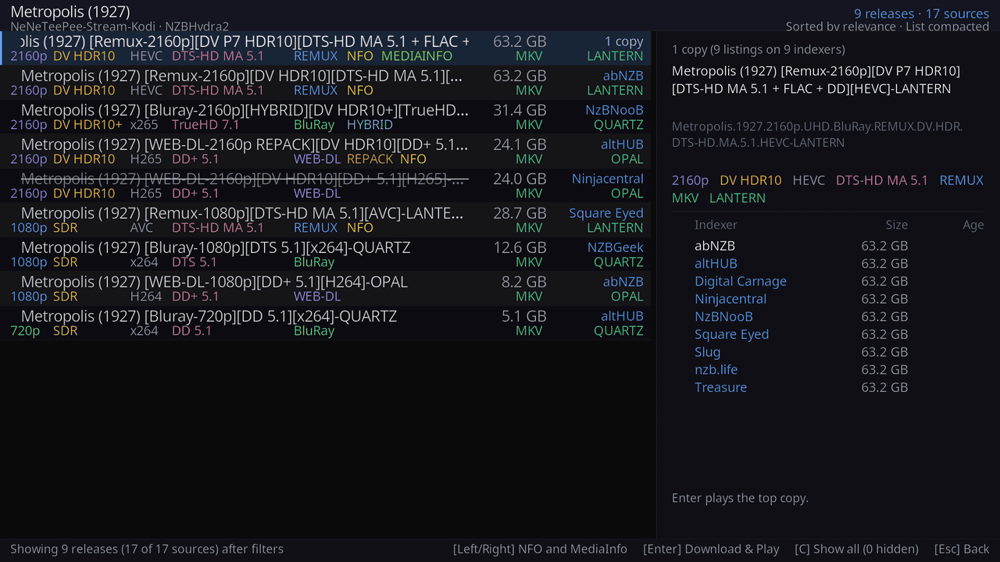
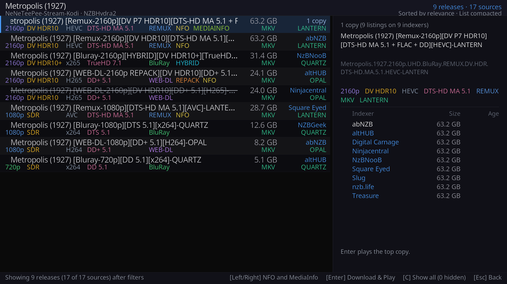
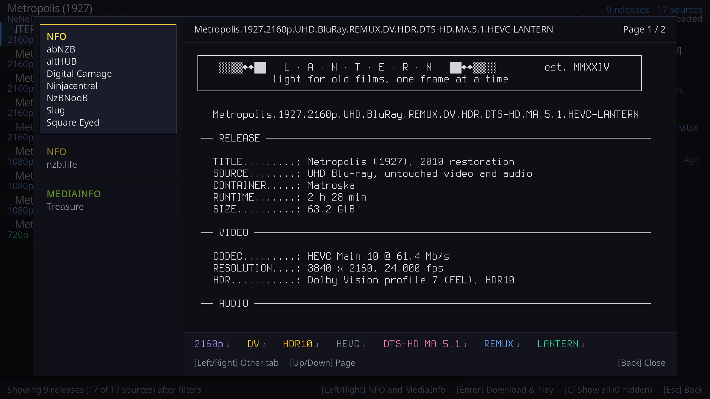
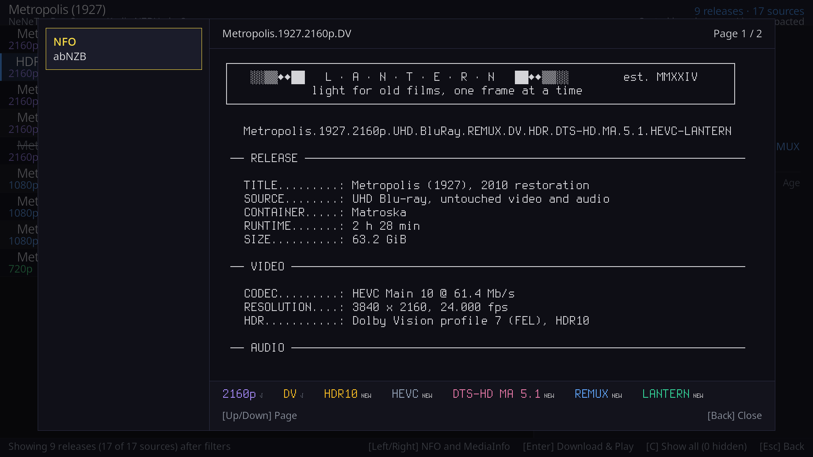
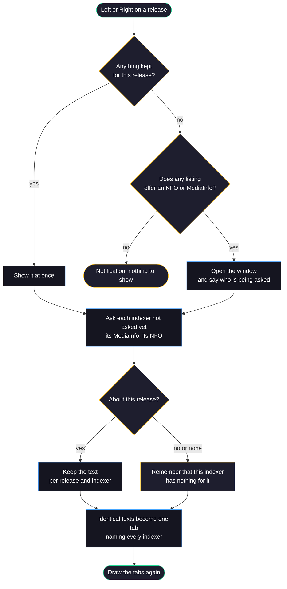

# NFO and MediaInfo viewer

A release's NFO is the note its group wrote about it: the source, the video
and audio tracks, the subtitles. MediaInfo is the tool's own report of the
file. Both say more than a release name can. Press **Left** or **Right** on a
release in the picker and NeNeTeePee-Stream-Kodi shows them, over the list,
without leaving it.

*Recorded in a test Kodi against stand-in indexers. The film is Metropolis
(1927); the releases, the NFO and the group are made up.*

## Which releases have one

A row in the picker carries a tag for what there is to open:

| Tag | When it shows |
| --- | --- |
| `NFO` | A listing of the release came with a link to an NFO, or an NFO for the release was already read. |
| `MEDIAINFO` | A MediaInfo report for the release was already read. The indexers that serve MediaInfo do not say which releases have a report, so this tag appears once one was fetched: by the search, for its top releases, or by this viewer. |

The tags sit with `HYBRID` and `REPACK`, in one label under the name. The
bottom bar lists the shortcut: `[Left/Right] NFO and MediaInfo`. You can open
the viewer on a row with no tag too. It then asks the indexers that list the
release, and tells you when none has anything.

## What the window shows

- **One tab per unique text, on the left.** Indexers mostly carry the very
  same NFO, so identical texts share a tab, and the tab lists every indexer
  that carries it. A tab is as tall as that list. When a release has several
  different NFOs, or an NFO and a MediaInfo report, each gets its own tab.
- **The release's name and the page, on top.** For a MediaInfo report the
  name is the file the report is about. `Page 1 / 3` means two presses of
  Down show the rest. How much fits on a page follows your screen: the text
  is drawn as large as still shows an NFO's 80 columns, pixel for pixel, so a
  1440p screen shows more lines per page than a 1080p or a 4K one.
- **The text, in a terminal font.** NFO art is drawn for a character grid
  with the box and block characters of the old PC character set. Kodi skins
  seldom have a monospace font, and an add-on cannot bring its own into a
  skin, so the add-on draws the text itself, with its own font, into an image.
  It looks the same on every skin.
- **What the text says of the release, underneath.** Resolution, dynamic
  range, video codec, audio, source and release group, in the picker's
  colors. Each has a small mark: a check when the listing's name already
  says it, or **NEW** when the text is where it comes from.

*This listing is named only `Metropolis.1927.2160p.DV`. Its NFO confirms
2160p and Dolby Vision, and adds the rest.*

## Keys

| Key | What it does |
| --- | --- |
| Left or Right, in the picker | Opens the viewer on the focused release |
| Left or Right, in the viewer | The other tab |
| Up or Down | The page before or after |
| Back | Closes the viewer; the picker is where you left it |

## Where the texts come from

- **What the search already read is there at once.** The search reads the
  NFO or MediaInfo of its top releases to learn their audio (see
  [Audio from the NFO](quality-filtering.md#audio-from-the-nfo)). Those texts
  are kept, so the viewer opens on them without asking anyone.
- **Every indexer that lists the release is asked once.** When the viewer
  opens, each indexer that offers something for the release and was not
  asked yet gets one request for the NFO, and one more for MediaInfo where it
  serves that. This is what the release's own page on the indexer shows. The
  indexers are asked at the same time, the window opens right away, and the
  tabs fill in when they have answered.
- **Nobody is asked twice.** A text, or that an indexer had none, is kept in
  the add-on's data folder (`release_docs`, the newest 400 releases). Opening
  the viewer on the same release again asks no one.
- **An indexer that refuses is left alone for a day**, as in the search.
- **Another release's NFO is not shown.** Indexers attach NFOs by matching,
  and a listing can come with the NFO of a different film or of another
  group's encode. Such a text is dropped. A listing whose name has no release
  group is the one exception: an NFO that names the same film is shown, and
  what it adds is marked NEW.
- **Your API keys stay where they were.** The links carry them; the kept
  texts and the log do not.

## Without the font

If the add-on's font file is missing, the viewer shows the text in the skin's
own text box instead. Paging, tabs and the attribute row work the same. The
box and block characters of NFO art are written with plain characters (`+`,
`-`, `|`, `#`), since skin fonts lack them.
