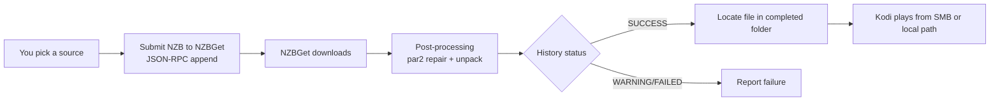

# NZBGet backend

!!! note "Availability"
    The unified **Playback backend** section and StreamNZB support ship in
    Beta 2.0.0-beta.3. Stable 1.2.3 doesn't include them. It configures
    nzbdav and WebDAV under **Connection** and supports nzbdav only.

By default, NeNeTeePee-Stream-Kodi downloads and streams through nzbdav. It can use
**NZBGet** as the backend instead. In that mode it submits the NZB to NZBGet
and waits for NZBGet to download and post-process it. It then plays the
finished file from an SMB share or a local/mounted path.

!!! info "Beta feature"
    The NZBGet backend was added in 2.0.0-beta.1 and is available on the
    [Beta channel](../getting-started/beta-channel.md). Stable 1.2.3 supports
    nzbdav only.

!!! warning "NZBGet mode replaces the streaming pipeline"
    In NZBGet mode, the nzbdav-specific features don't apply: live WebDAV
    streaming, the local stream proxy tiers, and mid-playback stream
    switching. NZBGet downloads and post-processes the whole file first. You
    then play it from the completed folder. Use this mode only if NZBGet is
    your download client.
    [Smart Duplicates failover](#smart-duplicates-failover) protects you
    against broken downloads instead.

## Enable and configure

Select **NZBGet** on **Playback backend**. Its connection and completed-folder
settings appear below the dropdown:

| Setting | Default | What to enter |
|---------|---------|---------------|
| **Playback backend → NZBGet** | nzbdav / InfiniDysk | Select NZBGet to switch to NZBGet mode. |
| **NZBGet URL** | `http://localhost:6789` | Your NZBGet address. |
| **NZBGet Username** | `nzbget` | NZBGet control username. |
| **NZBGet Password** | *(empty)* | NZBGet control password. |
| **NZBGet Category** | *(empty)* | The category to submit under. NeNeTeePee-Stream-Kodi also uses it to find the completed file when it can't read NZBGet's own `DestDir`. |
| **Completed Folder (SMB or Local Path)** | *(empty)* | NZBGet's completed-downloads base as Kodi sees it. This can be an SMB URL, for example `smb://server/downloads/completed`, or a local/mounted path such as an NFS mount, for example `/storage/nzbget/downloads`. An NFS hard mount is [recommended](#recommended-mount-the-completed-folder-over-nfs). |

Use **Test NZBGet Connection** to check the control API. Use **Test Completed
Folder** to check that Kodi can reach the completed folder. Playback fails with
"NZBGet not configured" if the URL or the completed folder is empty.

NZBGet mode also uses two settings from the **Polling** group on the
**Advanced** tab (shared with nzbdav / InfiniDysk). **Poll interval (seconds)** sets how often NeNeTeePee-Stream-Kodi checks
NZBGet. **Download timeout (seconds)** defaults to 3600 and is clamped to
60–86400. If the timeout runs out, NeNeTeePee-Stream-Kodi reports "Download timed out" and
leaves the job running in NZBGet, so it can finish for a later play.

<!--
Screenshot placeholder: capture Playback backend with NZBGet selected,
connection fields, and the two test actions.
To add: save it as docs-site/images/nzbget-settings.png, then replace this
comment with:  
-->

## Recommended: mount the completed folder over NFS

!!! tip "Highly recommended, especially on CoreELEC"
    For the most reliable playback, have your NAS export NZBGet's download
    folder over **NFS**. Mount it on the Kodi device as a **hard NFS mount**,
    and point **Completed Folder** at the local mount path instead of an
    `smb://` URL.

### Why not SMB

An `smb://` completed folder goes through Kodi's built-in SMB client, which
keeps a cached session to the server. That cache is a poor fit for NZBGet
downloads. NeNeTeePee-Stream-Kodi looks for the video as soon as NZBGet reports success, and
Kodi may probe a file while it is still being unpacked or moved. Kodi can then
keep a stale, half-written view of that file. The finished file lists but won't
open, often until you restart Kodi. NeNeTeePee-Stream-Kodi
[checks that the file is readable](#how-it-works) before playback and
tells you to restart Kodi when this happens, but it can't clear Kodi's SMB
cache for you.

A kernel NFS mount avoids that layer. The operating system does the file
access, it picks up changes on the server correctly, and Kodi just reads a
local path. A **hard** mount also waits and retries through a brief network or
server hiccup instead of returning errors to the player. Kodi's own `nfs://`
sources are better than SMB but still use Kodi's built-in client, so a
system-level hard mount is the best option for streaming NZBGet downloads from
another machine.

### Use an existing mounted folder

Mount the completed-download folder using your operating system or storage provider documentation. In the add-on, set **Completed Folder (SMB or Local Path)** to that mounted path, then select **Test Completed Folder**.

The mount must expose NZBGet’s completed files to Kodi. For server setup, use the [NZBGet project documentation](https://github.com/nzbgetcom/nzbget).

### Make the mount survive a slow network at boot

A `hard` mount retries forever, but only once the share is mounted. If the
network isn't up yet when the device boots, a plain systemd mount unit is tried
once, fails, and stays unmounted until the next reboot. Kodi then sees an empty
folder: NZBGet finishes the download, but playback fails, usually with **No video file
found in completed folder**.

On CoreELEC and LibreELEC, avoid this with an **automount** unit. systemd
then mounts the share the first time Kodi opens the folder, and tries again on
every later access until the NAS answers. This example mounts
`192.0.2.10:/export/downloads` at `/storage/nas`. The unit file names must
match the mount path, so `/storage/nas` becomes `storage-nas`.

`/storage/.config/system.d/storage-nas.mount`:

```ini
[Unit]
Description=NFS share for NZBGet downloads
Wants=network-online.service
After=network-online.service
Before=kodi.service

[Mount]
What=192.0.2.10:/export/downloads
Where=/storage/nas
Type=nfs
Options=ro,hard,timeo=30,retrans=2,noatime,nolock
```

`/storage/.config/system.d/storage-nas.automount`:

```ini
[Unit]
Description=Automount /storage/nas
Before=kodi.service

[Automount]
Where=/storage/nas
TimeoutIdleSec=0

[Install]
WantedBy=multi-user.target
```

Enable the automount, not the mount. If the share is mounted right now, stop
anything using it first: the `stop` line unmounts it, because systemd refuses to
start an automount on a path that is already mounted.

```sh
systemctl daemon-reload
systemctl disable storage-nas.mount
systemctl stop storage-nas.mount
systemctl enable --now storage-nas.automount
ls /storage/nas
```

Two details matter:

- Use `Wants=network-online.service`, not `Requires=`. With `Requires=`, a
  network wait that times out at boot cancels the mount outright.
- Leave the `[Install]` section out of the `.mount` file. The `.automount`
  unit is the one that starts at boot.

Set **Completed Folder** to the path NZBGet's downloads appear under, for
example `/storage/nas/nzbget/downloads`.

## How it works



- **Submission:** NeNeTeePee-Stream-Kodi fetches the NZB itself and uploads it through
  NZBGet's JSON-RPC `append` method with HTTP Basic auth. Over `http://` the
  username and password travel unencrypted, so use an `https://` **NZBGet
  URL** unless NZBGet runs on the same machine or a network you trust.
- **Post-processing:** NZBGet handles this itself, with par2 repair and
  unpack. The progress dialog names each stage while it runs: checking the
  files, repairing, unpacking, moving into place.
- **Strict success:** a job counts as successful only when NZBGet reports a
  `SUCCESS` status. A `WARNING` result counts as a failure, so you're never
  handed a corrupt file. That includes repairable or damaged downloads where
  repair didn't complete.
- **File discovery:** NeNeTeePee-Stream-Kodi maps the job's completed directory onto your
  configured completed folder. It uses NZBGet's `DestDir` option when it can
  read it, and otherwise works it out from the category. It then scans up to
  three folder levels deep for a playable video: `.mkv`, `.mp4`, `.m4v`,
  `.avi`, `.ts`, `.m2ts`, `.wmv`, or `.mov`. It keeps retrying
  for up to 60 seconds while NZBGet's moved files become visible. For movies, the largest
  video wins. For episode requests, it excludes samples, trailers, featurettes, and other
  extras, and a file named for the exact requested season and
  episode wins over larger videos. If the right episode can't be identified,
  the selection fails rather than playing a different episode.
- **Readability check:** NeNeTeePee-Stream-Kodi hands the file to Kodi only after reading its
  first bytes through Kodi's own file layer. A file can still be settling after
  NZBGet's move, or Kodi's cached SMB session can deny access even though the
  file is listed. In those cases NeNeTeePee-Stream-Kodi keeps retrying. If the file never
  becomes readable, it shows a notification: "Video file is listed but not
  readable. If this persists, check the share or mount and restart Kodi."
  This check was added in 2.0.0-beta.2.

## Smart Duplicates failover

The NZBGet backend downloads the whole release before playback, so it can't
switch streams live. It relies on NZBGet's own
[Smart Duplicates](https://nzbget.com/documentation/rss/#duplicates) instead.
When you pick a release with **Maximum duplicate backups** set to anything
other than `0`, NeNeTeePee-Stream-Kodi gathers NZBs of the **same release**, removes duplicate
listings and Usenet postings, and submits up to **50 unique members** in one
`appendfleet` JSON-RPC call. The default backup setting (`-1`) fills this fleet;
a positive value limits the number of backups, with 49 backups plus your pick
as the protocol maximum. Additional candidates are not submitted after that
fleet is accepted.

The request shares the existing **duplicate key** for the release: the normalized
release name, prefixed with a content ID when one is known. The positional request starts with `DupeKey`, category, priority, and the
45-second budget, followed by alternating NZB filename and content pairs.
Members are sent in preferred order, without scores. NZBGet health-checks them using its own news
servers for up to 45 seconds, starts the best working copy, and keeps backups
for automatic failover. The HTTP request has a 75-second timeout (45 seconds plus 30 seconds). The progress
dialog shows the number of good candidates and the chosen copy's health when
known, and a short notification repeats it, for example
`12 copies ready - health 100%`, or `6 of 8 copies ready - health 100%` when
some of the copies found could not be used. Your initial pick can differ from the copy
NZBGet chooses.

The add-on tracks the returned `Chosen` NZBID and follows NZBGet's automatic
failover to another member. An incomplete ranking response needs no extra
submission. Accepted fleets are never resent or FORCE-resubmitted. Only `KEY_BUSY` or `SHUTDOWN` replies with no chosen download are retried, up to twice, with a three-second pause. `ALREADY_QUEUED` follows the existing download and preserves its ownership. A release
already queued is followed; a release already downloaded is played from its
completed file after checking that Kodi can read it. A missing or unreadable
completed file produces an explicit error without submitting a new download.
If every copy is dead, the add-on reports that no working copy
exists. Request size, chosen ID, and the health list are logged for debugging.
Bulk job names include a copy number so replies can be matched after health
ranking. History views show the original release name. Recorded backup
identities support replay without new indexer grabs. A server that omits
member identity has its anonymous backups removed on cancellation.

Older NZBGet servers that return an unknown-method error (including
`Invalid procedure`) receive the existing individual `append` calls, using
shared duplicate keys and descending scores. Only this legacy path can use the
existing one-shot FORCE rescue. Authentication, timeout, or other errors do not
trigger individual appends because a bulk submission may already have succeeded.

If you cancel the play, NeNeTeePee-Stream-Kodi stops what's downloading: it
removes your pick and any backup NZBGet promoted or queued. The backups NZBGet
parked in its history (status `dupe`) stay there: they don't download, and if
you play the same release again within a day they're reused instead of
downloaded and sent again (see the 24-hour note below). Another play of the
same release isn't affected, and backups an earlier play left in NZBGet are
never removed by this play's cancel.

### What counts as the same release

The picker groups NZB copies with the same rule. A result is a backup when it
is the same content as your pick (title, year or season and episode, part) and
every parsed release field is equal:

- resolution, HDR (Dolby Vision, HDR10, HDR10+, HLG, or SDR when none),
  audio formats and channels
- codec and quality (source, such as WEB-DL or BluRay)
- edition, PROPER, REPACK and HYBRID
- the streaming service a WEB release names (`AMZN`, `NF`, `MAX`, `ATVP` and
  others), `iNTERNAL`, a `v2` re-release, and a smaller `m1080p` encode
- 3D, dubbed or MULTi, hardcoded-subtitle, and cut tags (Extended, Unrated,
  Uncensored, Remastered)
- release group
- the air date, for a daily show named by date instead of season and episode

A field one name states and the other leaves out counts as different. Language
and soft-subtitle tags aren't compared. A result with no release group is never
grouped with another, even one with the same name; a literal `NOGRP` or `P2P`
tag counts as a group. A raw Usenet subject (`[1/3] - "Name.mkv" yEnc`, with or
without its quotes, size or poster wrapper) is read as the release name inside it.

The parsed titles must be equal. Two shows from one group that share an episode
number, such as `The.Sopranos.S02E01` and `The.Office.US.S02E01`, are never one
release. An apostrophe one listing dropped doesn't make two titles.

**Spelling never matters.** Indexers list one release with dots, spaces or
underscores between words, with a hyphen or a dot before the group, and with a
plus sign kept or replaced (`DD+7.1` and `DD_7.1`, `HDR10+` and `HDR10_`). Names
that are equal once case and punctuation are removed are read as one name, using
the spelling that parses with the most detail. So `English-HONE` and
`English.HONE` are both group HONE.

**Oddly sized copies.** NeNeTeePee-Stream-Kodi never uses file size to decide
whether two results are the same release. A release name can still cover very
different posts: a 10 GB episode listed forty times and once at 91 GB, or once at
60 MB. Among three or more sized copies of a release, one more than 1.35 times
larger or smaller than the median is treated as an odd copy. Under Relevance it
is listed below the release's normally sized copies, so it never leads the
release, and it is never sent as a backup of a normal copy. The backup pool reuses same-title uploads retained from the
initial NZBHydra2 response before picker filtering. It does not search again
after selection, including when no cached peers exist. Uploads hidden by Hydra
are unavailable unless included in that response. Exact-name matches rank
first, then the other same-release results, then the retained NZBHydra2 uploads.

### Skipping the same Usenet posting

Several indexers often list one posting. Submitting it twice adds no
protection, so before it submits anything NeNeTeePee-Stream-Kodi collapses
listings of the same posting:

- Listings with the same size that were posted within 120 seconds of each
  other count as one posting. Only one is downloaded from the indexer, which
  saves indexer grabs. NeNeTeePee-Stream-Kodi uses the others only if that
  download fails.
- NZBs that share more than 1% of their article IDs count as one posting.
- Re-uploads of the same file with different article IDs are kept. They live
  on different articles, so they're the best backups.

### What the dialog shows while downloading

While the copies are handed to NZBGet, which can take most of a minute when
NZBGet health-checks them, the dialog says where they came from and what was
left out:

```text
Sending 6 NZBs to NZBGet...
abNZB, altHUB, Ninjacentral, Square Eyed, Zurg x2
Not sent: Digital Carnage refused 1, 1 duplicate upload
```

A copy is left out when its indexer refused the download, when its NZB could
not be downloaded for another reason, or when it turned out to be the same
Usenet posting as a copy already kept (a duplicate upload).

Once NZBGet has the copies, the progress dialog shows up to four lines:

```text
Copy 2 of 12 (abNZB, 4 days) - downloading 43%
4.5 of 10.4 GB - 62 MB/s - about 1m 35s left
Copy 1 failed: too many missing articles
155 articles missing - 155 recovered from backups
```

- **Line 1** is the copy being followed, the indexer that supplied it and how
  long ago it was posted, and what NZBGet is doing with it. The copy NZBGet
  starts with is copy 1, and the number goes up each time NZBGet switches to a
  backup. The stage is the download percent, or `waiting in the queue`,
  `checking the files`, `repairing`, `unpacking`, `moving into place`,
  `running NZBGet's scripts`, `repairing from backups` (RustyGet), or
  `finishing up`. A repair or unpack shows its own percent, and the bar
  follows it.
- **Line 2**, while it downloads, is how much has arrived, the speed over the
  last half minute, and the time left at that speed. After the download it is
  how long the current stage has run and, for a stage with a percent, an
  estimate of the time left: `25s so far - about 33s left`. A long move or
  script run is then not mistaken for a hang.
- **Up to two more lines** follow, the most important first:
    - a copy that failed, with the reason in plain words, such as `too many
      missing articles`, `it could not be repaired`, `it could not be
      unpacked` or `it needs a password`. After a second failure it reads
      `2 copies failed. Last one: ...`;
    - the articles no server had, and what the server got back for them:
      `155 articles missing - 155 recovered from backups`, or
      `106 MB rebuilt by stream repair` (RustyGet);
    - what the backups are, on a server that reports it (RustyGet):
      `Backups: 2 twins, 3 alts`. A **twin** is a byte-identical copy the
      server can borrow missing articles from. An **alt** is a different
      upload kept as a fallback;
    - what was not sent, if anything was.

NZBGet doesn't report how many par2 blocks a repair needs while it runs, so
the dialog shows the missing-article count and the repair's percent.

While the add-on waits for NZBGet to start the next copy, the dialog shows the
failure and `Waiting for the next copy...`.

### Speed and indexer limits

When you pick a release, the progress dialog walks through every NZB before
NZBGet starts downloading:

1. **Looking for duplicate NZBs...**: NeNeTeePee-Stream-Kodi gathers the
   same-release results and the retained NZBHydra2 uploads. It reads these
   from the search it already ran, so this step downloads nothing.
2. **Downloading NZBs 1 of 25** ... **25 of 25**: it downloads every NZB file
   itself, your pick included, and checks each one against the NZBs it already
   kept. Each unique NZB is saved to a folder in Kodi's temp directory as soon
   as it passes; duplicates are discarded. If your pick's indexer fails,
   another indexer's copy of the same posting is used.
   An indexer that refuses an NZB (HTTP 401, 403 or 429) is skipped for the
   rest of that play, apart from your pick. With debug logging on, the log
   names the indexer and the result of every NZB fetch.
3. **Sending 25 NZBs to NZBGet...**: it sends one fleet request, waits for
   NZBGet's health ranking, then deletes the temp folder. Collection stops
   once 50 unique members (or your lower configured limit) are ready.
4. **Copy 1 of 12 - downloading 43%**: the download progress for NZBGet's
   chosen copy. See [What the dialog shows while downloading](#what-the-dialog-shows-while-downloading).

Cancel before upload: nothing is sent. A bulk fleet accepted after user
cancellation is removed; Kodi shutdown leaves accepted work running. A later
play follows an existing queued release or plays its completed file.

On older servers, cancellation keeps parked backups and caches the pick's NZB
for a day so a replay can reuse them.

On older servers using individual appends, playing the same release again
within a day does not send the same backups again. NeNeTeePee-Stream-Kodi remembers every NZB it sent to NZBGet for 24
hours, in `nzbget_submitted.json` in the add-on's data folder
(`/storage/.kodi/userdata/addon_data/plugin.video.nzbdav/` on CoreELEC). That
record keeps the NZB link without its API key. On a replay, a backup is
skipped before it's downloaded when NZBGet still holds that copy under the
same duplicate key:

- **Still a backup** (queued, or parked in history as `dupe`): it isn't sent
  again, and failover can still switch to it during this playback.
- **Failed, or refused as a copy**: it isn't sent again, because it would fail
  or be refused again.
- **Deleted, completed, or gone from NZBGet's history**: it's sent again as a
  fresh backup.

Your pick is always sent.

!!! warning "Backups use indexer grabs"
    With unlimited backups, every backup costs one NZB download from your
    indexer. Those downloads count against your indexer's API and grab limits.
    Earlier versions also ran a same-content search that downloaded every
    candidate a second time before anything was sent to NZBGet; it no longer
    runs on the NZBGet backend. If your indexer has a tight daily grab
    limit, set **Maximum duplicate backups** to a small number, or to `0` to
    turn backups off.

!!! note "NZBGet options that affect failover"
    For automatic failover, NZBGet's **HealthCheck** option must be `Delete`,
    `None`, or `Park`. The modern default is `Delete`. With `Pause`, NZBGet
    pauses a broken download instead of promoting a backup. The add-on shows a
    notice about this once per Kodi session. If NZBGet's **DupeCheck** is `no`,
    NeNeTeePee-Stream-Kodi skips the backups entirely, because NZBGet would download them all
    in parallel.

The backups are best-effort. A backup that fails to submit never affects your
pick's download or playback. Only the **Maximum duplicate backups** setting
(`nzbget_max_backups`, on the **Playback backend** tab) controls them. It caps how many
NeNeTeePee-Stream-Kodi submits. `-1`, the default, sends every same-release NZB
it finds. `0` sends none, so the add-on submits only your pick. A positive
number sends at most that many.

**Enable fallback streams** and **Maximum standby fallback streams** apply only
to the nzbdav / InfiniDysk backend, and Kodi hides them when NZBGet is
selected. Earlier builds also let **Enable fallback streams** turn NZBGet
duplicate backups off. A one-time migration sets **Maximum duplicate backups**
to `0` if you used NZBGet with **Enable fallback streams** off, so your
behavior doesn't change.

## Reusing already-downloaded files

If NZBGet already downloaded a title successfully, the picker marks it with a
green **DL** tag. A result gets the tag when its name matches a `SUCCESS`
history item, its size is within 15%, and its recorded Usenet post date
matches. If you play it, NeNeTeePee-Stream-Kodi reuses the completed file directly instead of
resubmitting it. This is deliberate: NZBGet's duplicate check would otherwise
delete a resubmission of a `SUCCESS` item and fail the playback.

NeNeTeePee-Stream-Kodi also remembers completed folders that hold at least two reliably named
episodes from one season as season packs. When the exact episode you want is
in such a pack, later episode pickers show an
**Already downloaded season pack - Episodes …** row before the online releases.
Each record is tied to the `nzbget` backend, the exact NZBGet `NZBID`, and that
job's `DestDir`. Files from another job are never merged in just because its
name looks the same. When you select the row, NeNeTeePee-Stream-Kodi checks that exact
successful history item and completed folder again. It then plays the
requested episode without a new submission.

NeNeTeePee-Stream-Kodi removes a record when it goes stale: the job is confirmed missing, the
folder changed, or the folder is reachable but no longer holds the requested
episode. You then see "The downloaded season pack is no longer available.
Choose another result." Temporary NZBGet, share/mount, authentication, or
network errors fail that reuse attempt but keep the record. Either way, the
ordinary online results stay available.

!!! info "Beta feature"
    Exact season-pack episode reuse was added in 2.0.0-beta.2 and is available
    on the [Beta channel](../getting-started/beta-channel.md). It works the
    same way on the nzbdav backend.

## Resume and playback

NZBGet mode supports the same resume-or-restart prompt as the nzbdav path.
When you replay a release, you can choose **Resume from …** or **Start from
beginning**. The prompt follows Kodi's own default play action setting. The
background service saves your resume point when you stop playback.
