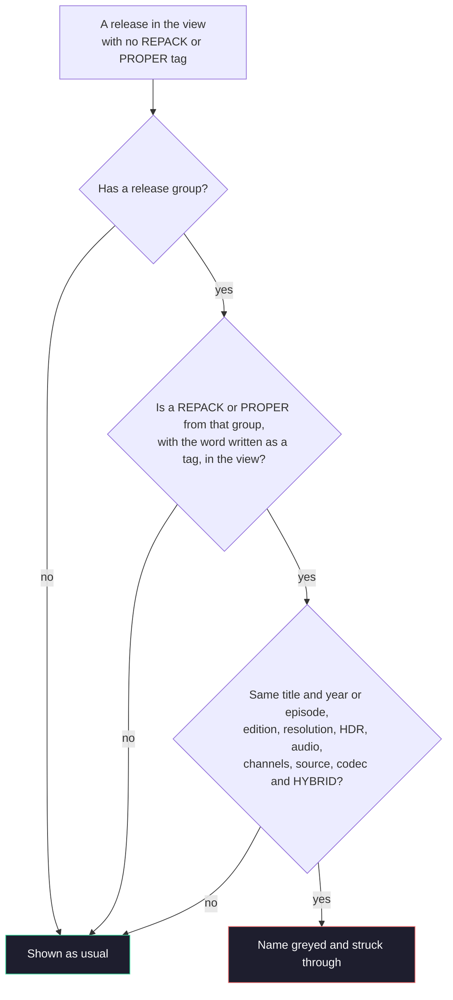
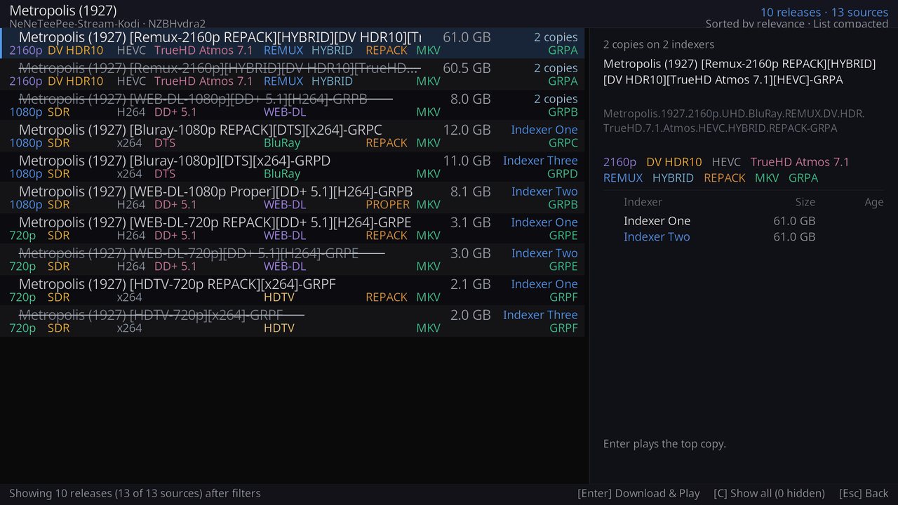
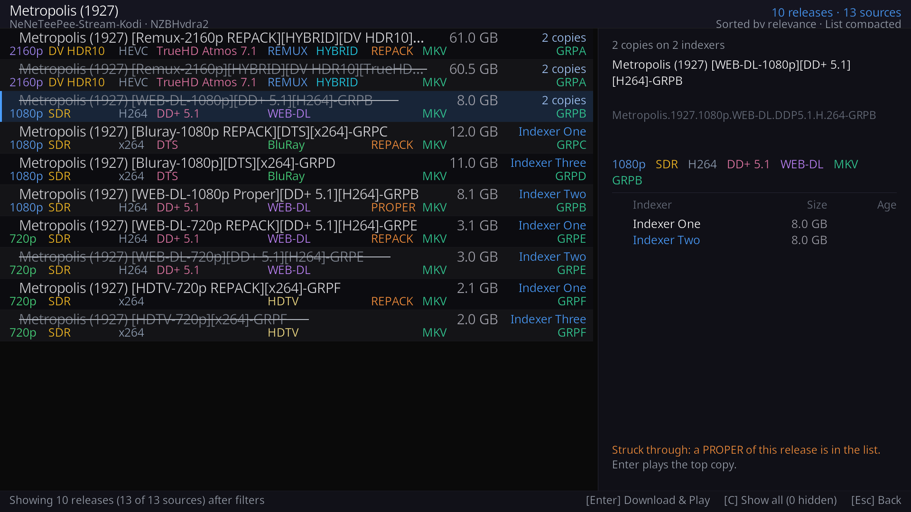

# Quality filtering and sorting

NeNeTeePee-Stream-Kodi filters the combined search results down to what you actually want, then
ranks what's left. Format filters live on **Quality filters**, followed by a separate
**Languages** tab. Group preferences, size, and keywords live on **Keyword filters**;
ranking lives on **Sorting**. Filters never lock you out: the picker can always
[show the releases they removed](#filtered-and-all-results-in-the-picker).

<!--
Screenshot placeholder. Capture the Quality filters settings tab showing the
resolution, HDR, audio, codec, and language toggle groups.
To add: save it as docs-site/images/quality-filters.png, then replace this
comment with:  
-->

## Quality filters

Every quality toggle is **on by default**, which means "show everything." Turn
off the attributes you never want. NeNeTeePee-Stream-Kodi reads each release's attributes by
parsing its name.

| Group | Options |
|-------|---------|
| **Resolution** | 4320p / 8K, 2160p / 4K, 1440p / QHD, 1080p(i), 720p(i), 576p(i), 540p, 480p(i), 360p, 240p |
| **HDR** | HDR / HDR10, HDR10+, Dolby Vision, HLG, SDR |
| **Audio** | Atmos, TrueHD, DTS-HD MA, DTS-HD High Resolution, DTS:X, DTS, DD+ (EAC3), DD (AC3), AAC, FLAC, PCM / LPCM, Opus, MP3, ALAC, Vorbis, MP2, WMA, AC-4 |
| **Video Codec** | x265 / HEVC, x264 / AVC, AV1, VP9, MPEG-2, MPEG-4 ASP / Xvid / DivX, VC-1, MPEG-1, VP8, WMV, H.263, VVC (also matches H.266), MJPEG, Theora |
| **Languages** (own tab) | 48 languages, including Cantonese and Urdu; names and abbreviations are matched case-insensitively |

Each group also has **Other / Unknown**, enabled by default. It allows
releases whose attribute is missing or has no dedicated option. Turn it off to
require a recognized value in that group. It never overrides a known format
you've cleared. If you clear every known option in a group, known formats
are no longer restricted there; **Other / Unknown** still applies on its own.

There are four HDR types: Dolby Vision, HDR/HDR10, HDR10+ and HLG. A release
with none of their tags is **SDR**, so an explicit `SDR` tag changes nothing.
`HDR` selects HDR/HDR10; `HDR+`, `HDRP`, `HDRPlus`, `HDR10P`, and `HDR10+`
select HDR10+. Dolby Vision requires `DV`, `DoVi`, or `Dolby Vision`. Multiple
explicit HDR tags are retained, and a release passes when any selected format
matches. These are filename attributes, not a scan of the actual video tracks.

Resolution aliases share their filters: `2560x1440` is 1440p, `8K` and
`7680x4320` are 4320p, and 1080i/720i use the 1080p(i)/720p(i) selections.

Language abbreviations such as `fr` select French, and Latino/Latin American
Spanish select Spanish. A multilingual release passes when any selected
language matches. Cantonese and Urdu have their own toggles. If **Chinese** is
on, releases tagged Cantonese or Urdu also pass.

## Keyword and group filters

On the **Keyword filters** tab:

| Setting | Effect |
|---------|--------|
| **Exclude keywords** | Comma-separated. A release is removed if any keyword appears anywhere in its title. |
| **Required keywords** | Comma-separated. A release is removed unless every keyword appears in its title. |
| **Hide AI upscales** | Off by default. Removes releases tagged as an upscale. See [AI upscales](#ai-upscales). |
| **Min size** / **Max size** | In MB, `0` = no limit. A release outside the range is removed. If a release's size can't be read, it's treated as 0 MB, so a non-zero minimum removes size-less placeholder rows. If you set a maximum below the minimum, the add-on turns the size filter off and logs a warning. |
| **Preferred groups: Tier 1 / 2 / 3** | Comma-separated preferred groups, ranked in that order under Relevance. Defaults come from the TRaSH remux tiers. |
| **Configure Excluded Groups...** | Opens a multi-select of 94 known release groups. Checked groups are **removed**. Empty means no exclusions. |

!!! warning "Preferred and excluded groups behave differently"
    - **Excluded groups** are a hard filter that removes matching releases.
    - **Preferred groups** are **not** a filter. They only **boost ranking**
      under the Relevance sort. Choosing a preferred group never hides other
      groups. If you want only certain groups, use required keywords or
      excluded groups instead.

<!--
Screenshot placeholder. Capture the preferred tiers and Configure Excluded
Groups control.
To add: save it as docs-site/images/configure-groups.png, then replace this
comment with:  
-->

## Sorting and selection

On the **Sorting** tab:

| Setting | Options | Default |
|---------|---------|---------|
| **Sort by** | Relevance, Size (largest first), Size (smallest first), Age (newest first), Age (oldest first) | Relevance |
| **Results view** | List compacted, List | List compacted |
| **Max results** | Whole number, clamped to 1–10000 when sent to providers | 25 |
| **Auto-select best match (skip result list)** | Skip the picker and play the top-ranked result | Off |

### How relevance ranking works

When you sort by **Relevance**, NeNeTeePee-Stream-Kodi ranks releases by this priority order:

1. **Resolution:** highest resolution first, from 8K down to 240p; unknown
   resolution last. A 2160p release always ranks higher than a 1080p release,
   regardless of HDR or REMUX.
2. **Pinned groups:** a CiNEPHiLES release ranks first in its resolution and
   a FraMeSToR release second, ahead of HDR and everything below. These two
   are fixed, not a setting, and match without case sensitivity.
3. **Upscales last:** a release tagged as an upscale ranks below every
   other release of its resolution, whatever HDR, REMUX or audio tags its
   name carries. An upscale is video stretched from a lower-resolution
   source, so `Movie 4k [2160]-AI-Raws` is not a genuine 2160p release. See
   [AI upscales](#ai-upscales).
4. **Release group:** a release with a group ranks above one without, so a
   release with no group ranks last among the genuine releases of its
   resolution.
5. **Listed more than once:** a release with two or more NZBs in the results
   ranks above a release with only one. A real release is listed by several
   indexers; a single NZB from one indexer is often a stray or mislabelled
   post, and it would otherwise lead its resolution on a better HDR or audio
   tag. If every release of a resolution has one NZB, this step changes
   nothing.
6. **HDR:** Dolby Vision, HDR10+, HDR/HDR10, HLG, then SDR (no HDR tag). A
   release with several tags ranks by its best.
7. **Release type:** REMUX releases tagged HYBRID first, then other REMUX
   releases, then everything else.
8. **Audio:** three tiers, ranked by the release's best track:
    1. lossless: TrueHD (with or without Atmos), DTS-HD MA (with or without
       DTS:X), FLAC, PCM and ALAC;
    2. lossy with object audio: Dolby Digital Plus with Atmos, and lossy
       DTS:X;
    3. everything else: Dolby Digital Plus, Dolby Digital, DTS, DTS-HD High
       Resolution, AAC, Opus, MP3, and a release whose name tags no audio.

    Formats in one tier tie, so FLAC ranks beside TrueHD Atmos. The last
    tier is flat because a name that leaves the audio out usually carries
    the same Dolby Digital or DTS track that another name spells out.
9. **Preferred group:** **Tier 1**, then **Tier 2**, then **Tier 3**, then
   groups in no tier. Group names match exactly, without case sensitivity.
   Audio is compared first, so Dolby Digital Plus with Atmos from a group in
   no tier ranks above plain Dolby Digital Plus from a preferred group.
10. **NZB copies:** among releases still tied, the release with more NZBs in
   the results sorts first, so a pick has more backups if one NZB fails.
   Copies are counted with the [same-release rule](nzbget-backend.md#what-counts-as-the-same-release)
   that NZBGet duplicate backups use, so a release with no group counts only
   itself.
11. **Size:** larger files win the final tie-break.

#### How audio tags are read

Atmos and DTS:X are object audio carried on top of another track. Atmos rides
on TrueHD (lossless) or on Dolby Digital Plus (lossy), so a name with `DD` and
`Atmos` but no TrueHD is read as Dolby Digital Plus with Atmos, as is `DDPA5.1`.
DTS:X on a disc sits on DTS-HD MA and counts as lossless; a WEB release that
tags DTS:X without DTS-HD MA carries the lossy kind. `DD_5.1`, or `DD 5.1` in
a name that otherwise separates its words with dots, is read as `DD+5.1`: the
plus sign was replaced on the way from the indexer.

#### Audio from the NFO

A release name can leave its audio out altogether:
`Movie.2004.MULTi.1080p.BluRay.x264-GRP`. Such a release ranks as "audio
unknown", after every release that tags its audio. Its NFO usually says what
it carries: `Audio.........: English DTS-HD MA 5.1 @ 3739 kb/s`.

Some indexers send, with each search result, a flag that the release has an
NFO and a link to it, and NZBHydra2 passes both through. For the first
releases of a search that offer one, the add-on reads the NFO and uses the
audio formats and the channel count it names for the release:

- **MediaInfo first, where the indexer serves it.** An NFO is free text.
  MediaInfo is the tool's own report of the file and lists every audio
  track with its format, its Atmos or DTS:X marker and its channel count.
  Treasure Maps serves it from a second API on the same site
  (`/api/v1/releases/<id>/mediainfo`), so the add-on asks there first, with
  the key the NFO link carries sent in a header, and reads the NFO when the
  release has no MediaInfo. A release that several indexers list is asked
  about on the one that serves MediaInfo, and its NFO is read from an
  indexer that flags only the releases it has an NFO for. When that indexer
  has none after all, one more indexer's NFO is read.
- **Each indexer is asked only for what it has.** The add-on keeps a table
  of the indexers that were checked (see
  [What each indexer tells before a download](#what-each-indexer-tells-before-a-download)).
  An indexer in it without a MediaInfo call is never asked for one. An
  indexer that is not in it is asked once, and not again for a month when
  it has no such call.
- **Only the top releases** (`nfo_audio_releases`, 3 by default, 0 for
  off). Each release costs one API call on your account with an indexer,
  two when it has no MediaInfo and its NFO is read instead, and three at
  most, when the first indexer asked for the NFO had none.
- **Once per release.** The answer, or that the NFO named no audio, is kept
  in the add-on's data folder and applies to every listing of that release
  name from then on, whichever indexer lists it. A read that failed is tried
  again a day later.
- **An indexer that refuses is left alone for a day.** If one answers that
  the client is not allowed, the key is wrong or a limit is reached, the
  add-on sends it no more MediaInfo or NFO requests until the next day.
- **With several tracks of the main format, the fullest one counts.** A
  stereo Dolby Digital Plus track listed before the 5.1 one with Atmos does
  not make the release 2.0.
- **Atmos is only taken from the main track.** An NFO that lists a plain
  TrueHD track and a separate Dolby Digital Plus Atmos track does not make
  the release "TrueHD Atmos".
- **The picker waits two seconds at most.** A slower answer is stored when
  it arrives and used the next time the search is opened.
- **What was read wins over the name.** The formats and the channel count
  read from MediaInfo or the NFO replace the ones the name tags: a name that
  says `DTS.5.1` whose NFO says `DTS-HD MA 7.1` is labelled and ranked as
  DTS-HD MA 7.1, and a name that says `DDP.5.1.Atmos` whose NFO leads with a
  plain TrueHD 7.1 track is TrueHD 7.1, not "TrueHD Atmos". One thing is
  kept from the name: its Atmos or DTS:X tag, when a hand-written NFO leads
  with the track the name put it on. `Audio: English TrueHD 7.1` is how many
  NFOs describe an Atmos track. MediaInfo marks Atmos on the track itself,
  so it is used exactly as it reads.
- **Only when the NFO is this release's.** Indexers attach NFOs by matching,
  and a release can carry another release's NFO. Each NFO is checked
  against the release's name. One that names the release (or the same film
  or episode from the same group) is used as above. One that names another
  film, another episode or another group's release is not used at all. One
  that names no release, such as a bare MediaInfo dump, only adds to what
  the name tags and replaces nothing. MediaInfo from the indexer's API is
  made from the release's own file and needs no such check.
- **No Atmos guess for a release that was read.** The rule under
  [Atmos a name leaves out](#atmos-a-name-leaves-out) does not add Atmos to
  a release whose MediaInfo or NFO was read and names none. When the copy
  labelled Atmos turns out to have none, a copy that took the guess from it
  gives it back, unless another copy is still labelled Atmos by its name.
- **The link is only followed to the indexer the result came from**, and is
  never written to the log: it carries your API key for that indexer.

MediaInfo's names are understood: `E-AC-3 JOC` is Dolby Digital Plus with
Atmos, `MLP FBA 16-ch` is TrueHD with Atmos, `DTS XLL` is DTS-HD MA.

#### Dynamic range from MediaInfo

MediaInfo also describes the video. From the same answer, with no extra
request, the add-on reads:

- **the HDR format**: Dolby Vision, HDR10+, HDR10, HLG, or none (SDR);
- **the Dolby Vision profile** (`dvhe.05` is profile 5, `dvhe.08` profile
  8), shown in the release's name in the picker as `[DV P5]` or
  `[DV P8 HDR10]`;
- **the bit depth** of the video.

The HDR format replaces what the name tags, for the label, the HDR filter
and the ranking: a name tagged `HDR` whose file is 8-bit BT.709 is SDR, and
a name with no HDR tag whose file is Dolby Vision profile 8 ranks as Dolby
Vision. One case only adds to the name: a report that shows a PQ transfer
and names no HDR format (an older MediaInfo) says HDR10, and a `DV` tag in
the name is kept beside it.

The source is the indexer's MediaInfo call where it has one. Many NFOs are
MediaInfo's text report: the `Video` block of such an NFO is read too, when
the NFO holds this release's own name. An NFO that names the same group's
other encode of the film (its 1080p BluRay beside this 2160p WEB-DL) still
counts for the audio, as before, but its video is not this release's. A
hand-written NFO's `Video: x264 @ 15371 kb/s` line names no dynamic range
and is not read for one.

#### What each indexer tells before a download

Checked with a few searches per indexer and each site's API page. "Flag and
link" means the indexer marks a result that has an NFO and sends the call
that returns it. No indexer sends the audio format of a release on a search
result.

| Indexer | NFO on results | MediaInfo call | What the add-on reads |
|---|---|---|---|
| Treasure Maps (SceneNZBs) | Flag and link on every result; many flagged releases have no NFO to give | `/api/v1/releases/<id>/mediainfo`, key in a header | MediaInfo (audio, HDR format, Dolby Vision profile, bit depth), else the NFO |
| nzb.life / NZB.su | Flag and link on most results | None | NFO |
| Ninjacentral | Flag and link on some results | None | NFO |
| altHUB | Flag and link on some results | None | NFO |
| abNZB | Flag and link on some results | None | NFO |
| Square Eyed | Flag and link on some results | None | NFO |
| NzBNooB | Flag and link on some results | None | NFO |
| Digital Carnage | Flag and link on some results; the link carries the key as `r`, which its API refuses | None | NFO, with the same key sent as `apikey` |
| Drunken Slug | A link (`t=info`) on the few results that have an NFO, no flag; the key as `r`, which its API refuses | None | NFO, with the same key sent as `apikey` |
| NZB Finder | Neither | None; its JSON API v2 details repeat the search fields | Nothing |
| NZBGeek, nzbplanet, miatrix | Neither seen (miatrix flags every result as having no NFO) | Not checked: without a link the add-on has no key to ask with through NZBHydra2 | Nothing through NZBHydra2 |

Several indexers also send the audio languages and subtitle languages of a
release on the search result (Treasure Maps, NZBGeek, nzb.life; subtitles
also abNZB, Digital Carnage, NZB Finder). Treasure Maps' release details
call (`/api/v1/releases/<id>`) returns the same languages, subtitles,
password state and post time as its search result, and lists an NFO and a
MediaInfo link for releases that then answer "not found", so the add-on
does not call it.

**Through NZBHydra2** the add-on has no key of its own for an indexer. The
link an indexer sends with a result carries the release's id and your key,
and every request is built from such a link, to that indexer only. A result
that brings no link, from an indexer that serves MediaInfo, is asked about
with the key from another result of the same indexer in the same search.

**With direct indexers** the add-on holds each indexer's key, so it builds
the calls itself from the release's id: the NFO call for a result the
indexer flags as having an NFO (`t=getnfo`, or `t=info` on Drunken Slug),
and the MediaInfo call for any result of an indexer that has it. A direct
indexer that is not in the table is asked once for MediaInfo, as above.
There is no per-indexer switch: `nfo_audio_releases` covers every indexer,
and an indexer is only asked for what it has.

#### Atmos a name leaves out

Groups name the same stream differently: one writes `DD+5.1.Atmos`, another
`DDP5.1` for the same Amazon download. A WEB-DL tagged Dolby Digital Plus
without Atmos is treated as Atmos, in the picker and in the ranking, when
another result of the same search is tagged Dolby Digital Plus with Atmos and
is:

- the same movie (same year and cut) or the same episode;
- from the same streaming service (`AMZN`, `ATVP`, ...);
- the same resolution, video codec and channel count;
- tagged with the same audio languages, or none, and the same dubbed or
  MULTi flags, since a dub is another audio track.

It applies to WEB-DL only, since a WEBRip or a disc encode carries whatever
audio its encoder chose. A row that names no service takes nothing. A
**HYBRID** release neither gives nor takes: it combines sources, so its audio
may come from somewhere else. Only a tag written in a name counts as the
source; a row that took Atmos this way never passes it on.

The three editable, comma-separated preferred group lists default to the
[TRaSH tier 1](https://github.com/TRaSH-Guides/Guides/blob/master/docs/json/radarr/cf/remux-tier-01.json),
[tier 2](https://github.com/TRaSH-Guides/Guides/blob/master/docs/json/radarr/cf/remux-tier-02.json), and
[tier 3](https://github.com/TRaSH-Guides/Guides/blob/master/docs/json/radarr/cf/remux-tier-03.json)
definitions retrieved on September 5, 2026. NeNeTeePee-Stream-Kodi bundles their published
group expressions locally, so a search doesn't fetch the guides. Clearing a tier leaves
it empty. Group preferences affect ranking, never whether a release is kept.
The Size and Age modes sort only by that property. Age uses the release's post
date; a missing or unreadable date sorts as the oldest, and an unreadable size
as 0.

#### AI upscales

An upscale is a release whose video was stretched to a higher resolution
than its source, today mostly by an AI model. Its name states the new
resolution, so without a rule of its own it sat with the genuine releases
of that resolution, and led them when its name carried better tags. The
add-on reads the tag and does two things with it:

- under **Relevance**, an upscale ranks last in its resolution, below
  releases with one NZB and releases with no group. This is not a setting;
- with **Hide AI upscales** on (**Keyword filters**), upscales are removed
  from the results. In the picker's show-all view they carry
  `FILTERED: AI upscale`.

Only a tag counts:

| Counts as an upscale | Examples |
|---|---|
| A release group that is `AI` or has it as a word of its name | `...[2160]-AI-Raws`, `[AI-Raws] Show - 01`, `...h264-AI` |
| `AI` beside an upscale word, anywhere in the name | `AI.Upscale`, `AI UPSCALED`, `Upscaled.by.AI` |
| An upscale tag after the year, episode or resolution | `2160p.UPSCALED.BluRay`, `ESRGAN.Upscale`, `UpsUHD` |
| A bare `AI` among the technical tags | `1994.2160p.AI.BluRay.x265`, `[BD 2160p AI]` |

`AI` in a title is never a tag: `A.I. Artificial Intelligence (2001)`,
`The.AI.Doc.2026.1080p` and the episode `S22E11.Alien.A.I.1080p` are left
alone, as are the letters inside a word or a group name (`Air`, `RAiN`).
An episode's own title follows its number, so in an episode's name a bare
`AI` counts only after the resolution or source. `AI.Subs` and `AI.Dub`
(machine-made subtitles or voices) are not upscales, and neither is
`Enhanced` on its own (`IMAX.Enhanced`).

In the picker an upscale is named `[Bluray-2160p][UPSCALE]` and carries a
red `UPSCALE` tag where HYBRID is shown. An upscale is a different file
from the release it was made from, so the two are never grouped as copies
of one release or used as each other's NZBGet backups.

### About "Max results"

**Max results** applies in two places: it caps how many results each provider is
asked for, and it truncates the filtered list you see. The picker's show-all
view (below) is not truncated. With **Auto-select best match** on, NeNeTeePee-Stream-Kodi
plays the first release that passed your filters after ranking, so "best"
always means "the top item under your current sort order." If nothing passed
your filters, the picker opens instead.

## Picker views

**Sorting › Results view** picks how the picker lays out results:

- **List compacted** (default) shows each release once, however many indexers
  carry it, with its copy count on the right of the row. The count is of
  separate uploads: several indexers listing one upload (the same size,
  posted within two minutes) are one copy. The panel says how many listings
  that came from when the two differ: `8 copies (11 listings on 9
  indexers)`. It is the count known before anything is downloaded; two
  listings kept apart here can still turn out to be one posting once their
  NZBs are compared. A panel on the right
  lists the indexers that carry the focused release, one line each, with a
  count when an indexer lists it more than once (`NZB Finder x3`) and the size
  and age of that indexer's best copy, or a range when its copies differ
  (`39-42 GB`, `20d-2mo`). A green
  **DL** on the row means a copy is already downloaded. Press ++enter++ to
  play the downloaded copy if there is one, otherwise the top-ranked copy.
- **List** shows every indexer copy on its own row, as earlier versions did.

Copies are grouped with the [same-release rule](nzbget-backend.md#what-counts-as-the-same-release):
the same title and year or episode, and equal resolution, HDR, audio,
channels, codec, quality (source), edition, PROPER/REPACK, HYBRID, 3D, dubbed,
hardcoded-subtitle and cut tags, release group, and a daily show's air date. Language and soft-subtitle tags don't split a release, and a
result with no release group is never grouped with another. How a name is
spelled (dots, spaces, underscores, a replaced plus sign) never splits one.

A copy whose size is far from the release's typical size, such as a 91 GB
listing of a 10 GB episode, is listed last among the release's copies, so
++enter++ plays a normally sized one.

### How a release is named in the picker

Indexers list the same release as a dotted name, a spaced one, or a raw Usenet
subject such as `[1/3] - "Name.mkv" yEnc 4400443301`. The picker shows every
row in one format, built from what the name itself says:

```text
Dune Part Two (2024) [Remux-2160p][HYBRID][DV HDR10+][TrueHD Atmos 7.1][HEVC]-CiNEPHiLES
Six Feet Under (2001) - S02E01 [AMZN][WEB-DL-1080p][DD+ 5.1][H264]-FLUX
```

That is the title and year, the episode for TV (the air date for a daily
show), the edition or cut in braces
(`{Unrated}`), then source and resolution, HYBRID, UPSCALE, 3D, DUBBED and HC
(hardcoded subtitles), HDR, the main audio track with its own channel count
and any second track after a `+`, MULTi or dubbed languages, the video codec,
and the release group. A split season pack keeps its part (`S01 Part 2`). A part the name doesn't
state is left out. File counters, `yEnc`, sizes, file extensions and posting
wrappers are never shown and never affect grouping. In **List compacted**, the
side panel shows the release name as the indexer listed it in grey under the
normalized one, so you can check how it was read. A name with no readable
title, source or resolution is shown as listed.

**HYBRID** has its own cyan slot on each row's second line, between the source
and the container. A hybrid release combines sources, such as one disc's video
with another's audio or Dolby Vision added to an HDR10+ encode. Only a
`Hybrid` tag after the year, episode or resolution counts; a title such as
*Hybrid (2007)* isn't one.

**REPACK** and **PROPER** have an orange slot beside it. A group posts a
REPACK (or a RERIP, which is shown as one) or a PROPER to replace a release of
its own that had a fault. When the list holds both, the replaced release's name
is greyed and struck through, and in **List compacted** the side panel says
which tag replaced it:

- The two must be the same release in everything but the tag: the same title
  and year or episode, edition, resolution, HDR, audio, channels, source,
  codec, HYBRID and release group, and every other field of the
  [same-release rule](nzbget-backend.md#what-counts-as-the-same-release).
- The word has to be written as a tag: in capitals, and either after the
  resolution and source or before them with only other tags between. `Proper`
  in an episode title or a guest's name, as in
  `Show.S03E02.A.Proper.Send.Off.720p`, strikes nothing. A name written all
  in one case can't be read by its capitals, so there the word is judged by
  where it stands alone.
- When the picker can't tell whether a release's own `Proper` or `Repack` is
  a tag, that release is never struck through either.
- Another group's PROPER strikes nothing. It is a different encode, not the
  same file fixed.
- A REPACK and a PROPER of one release don't strike each other.
- A release is struck through only while its replacement is in the view. If
  your filters hide the REPACK, the older release isn't struck through until
  you show all results.





In **List compacted**, the side panel of a struck-through release says which
tag replaced it:



A struck-through release still plays if you pick it. Kodi's text has no
strikethrough, so the picker draws the line and estimates its length from the
name; on some skins it runs a few letters past the end.

## Filtered and all results in the picker

The picker opens on the filtered list, and its header reads *Showing N of M
sources after filters*. To see everything the search returned:

- Press **C**, or use Kodi's context-menu button (long-press on most
  remotes), to switch to all results. The header changes to *Showing all N
  sources (filters off)*. Press it again to return to the filtered view.
- On CoreELEC/Linux devices where NeNeTeePee-Stream-Kodi can read the remote's input device,
  you can instead **hold OK for five seconds** to turn filtering off. A short
  press still selects a result. Releasing after the five-second hold doesn't
  select or download anything, and holding again keeps filtering off.

In the all-results view, every release your filters would remove carries a
yellow **FILTERED:** chip naming the first filter that rejected it:
`resolution`, `HDR`, `audio`, `codec`, `language`, `keyword`, `group`, or
`size`, checked in that order. You can pick one of these rows and it plays
normally. Nothing here changes your saved filter settings, and the footer
always shows the shortcuts available.

If no release passes your filters, the picker opens straight into the
all-results view, so you can still choose something.

For the exact ranking math and filter internals, see
[How it works → Search pipeline](../how-it-works/search-pipeline.md).
