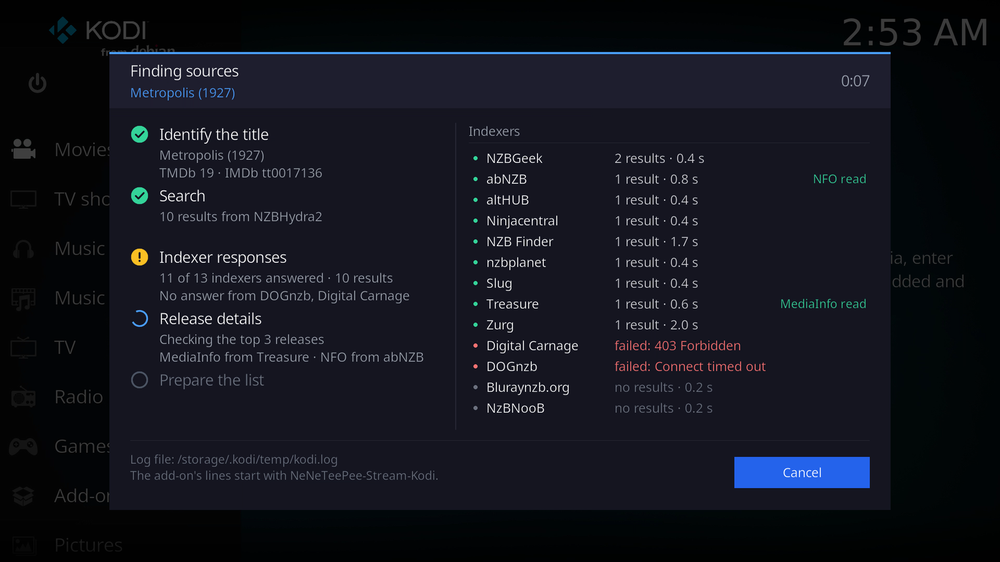
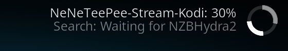

# Search progress window

After you press play, NeNeTeePee-Stream-Kodi shows a window that follows the
search step by step until the release list opens. It replaces the small busy
indicator earlier versions showed in the corner, so a slow indexer no longer
looks like a frozen screen.



## What each stage shows

The left side lists five stages. A spinning ring marks the stage in hand, a
green check a finished one, an amber mark a stage that finished with a
problem, and a grey dash a stage that was skipped. After two seconds the stage
in hand also shows how long it has been running.

| Stage | What it says |
| --- | --- |
| **Identify the title** | The film and year, or the show with its season and episode, and the TMDb, TVDB and IMDb IDs the player sent. An ID the add-on looked up itself (for example the TVDB ID of a show) is marked *looked up*. With no IDs, the search uses the title. |
| **Search** | Which provider it is waiting for (NZBHydra2, Prowlarr or direct indexers). When the ID search finds nothing and the add-on tries the title, it says so. At the end: how many results came back and from which provider, or why the search failed. Results reused from the [search cache](../settings/advanced.md) say how long ago they were saved. |
| **Indexer responses** | How many indexers answered and how many results they returned, and which ones did not answer. |
| **Release details** | Which indexers are asked for the NFO or MediaInfo of the top releases, and which supplied it. An indexer still busy when the short wait ends is named; its answer is kept for the next search. See [Audio from the NFO](quality-filtering.md#audio-from-the-nfo). |
| **Prepare the list** | Filtering and sorting, the check for releases already downloaded, and how many results match your filters before the list opens. With **Auto-select best match** on, it says the best match is being played. |

## The indexer table

The right side lists every indexer that took part, one line each:

- a green dot and the result count with the time the indexer took to answer;
- a red dot and the reason when an indexer failed, for example
  `failed: 403 Forbidden` or `failed: Connect timed out`;
- a grey dot for an indexer that answered with no results.

When the add-on read release details from an indexer, the last column says
what came of it: *MediaInfo read*, *NFO read*, *NFO: nothing new*, *NFO
refused*, or *failed*.

### Where the indexer lines come from

- **Direct indexers:** each indexer reports as soon as it answers, so the
  table fills in while the search runs. A slow indexer shows *searching…*
  until it answers or times out.
- **NZBHydra2:** Hydra's search answer lists the merged results only, not
  which indexers it asked. Right after the search, the add-on reads Hydra's
  own record of that search from its search history: two small requests to
  your Hydra, none to any indexer, and only while this window is showing. This needs **Keep history** on in Hydra's
  main settings (on by default). If Hydra's web interface requires a sign-in,
  or the history is off, the table instead lists the indexers named in the
  results, with their result counts, and the failures are not shown.
- **Prowlarr:** the table lists the indexers named in the results.

## Cancel

Press **Cancel** or **Back** to stop. The window closes at once. A request
already sent to your search provider is not interrupted; when it returns, the
add-on stops quietly without opening the list or downloading anything.

## The log file

The bottom of the window shows where Kodi writes its log on your device (for
example `/storage/.kodi/temp/kodi.log` on CoreELEC) and the prefix of the
add-on's lines. Each stage change is also written to the log as a line such as:

```text
NeNeTeePee-Stream-Kodi: Search progress: Indexer responses [warn] 11 of 13 indexers answered · 10 results | No answer from DOGnzb, Digital Carnage
```

An NZBHydra2 indexer that failed gets its own line with the reason. See
[Troubleshooting](../operations/troubleshooting.md) for reading the log.

## Turning it off

Turn off **Sorting › Search Progress › Show search progress window**
(`search_progress_window`) to show only Kodi's small indicator in the top-right
corner. It now names the stage in hand instead of a fixed message:



The corner indicator is also used when a skin or Kodi build will not open the
add-on's window. Either way the search itself is the same.
