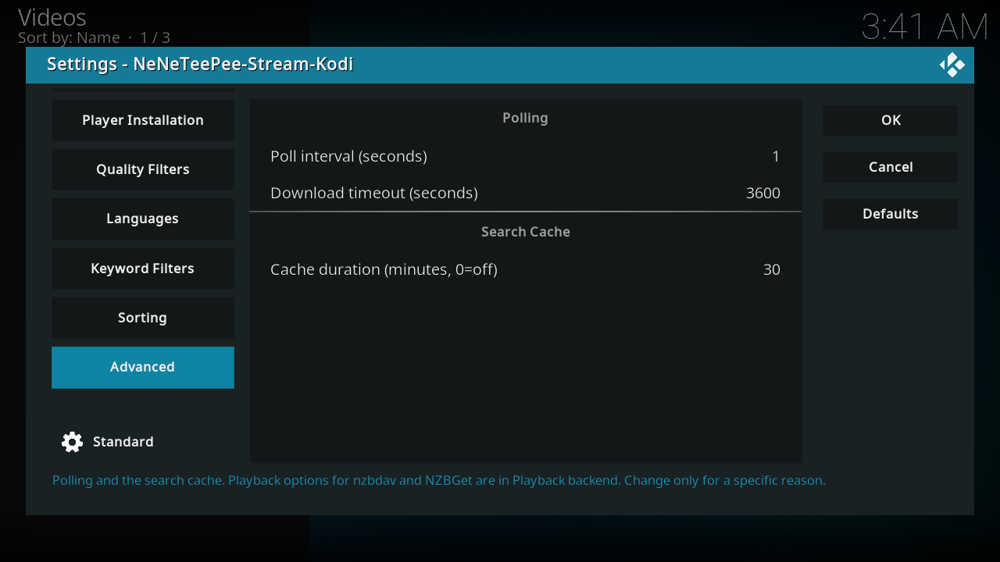
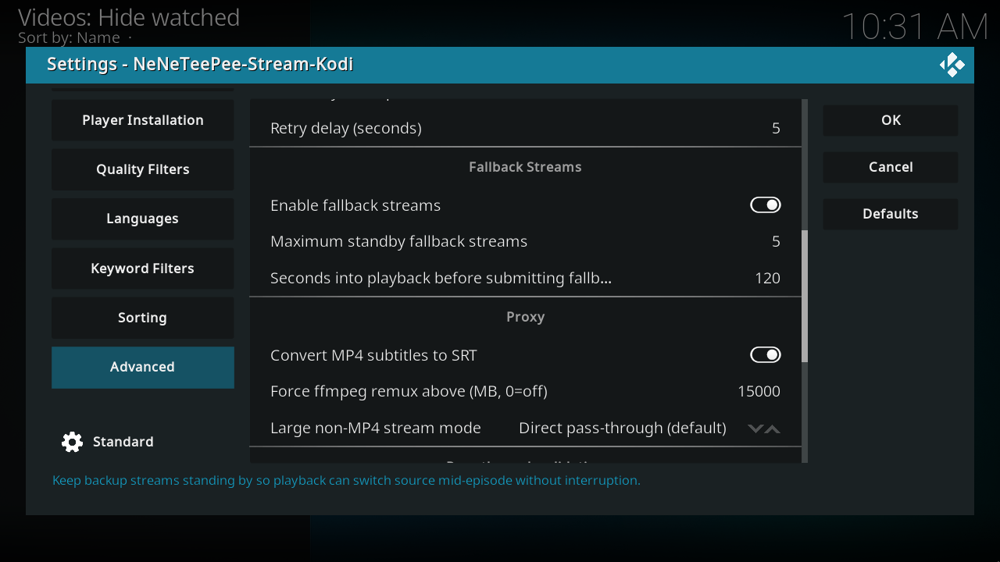
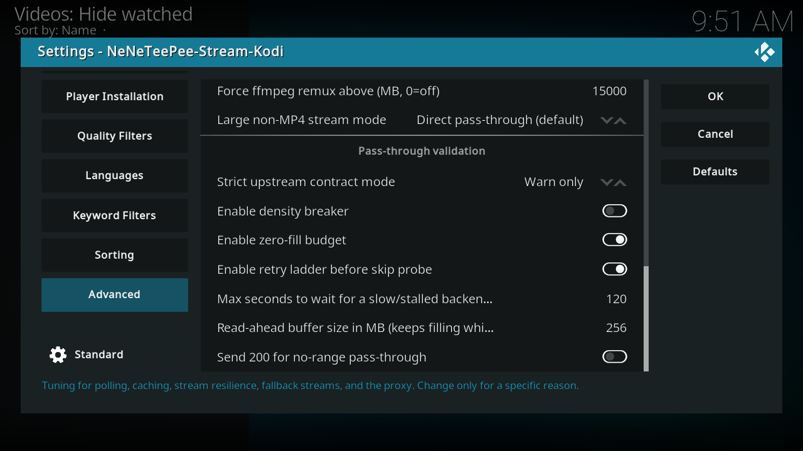

# Advanced

These options tune how the add-on polls for downloads and caches search results. Keep the defaults until you have a specific playback problem.

!!! note
    Submit timeout, clear-queue, stream resilience, fallback streams, proxy, and pass-through validation options moved to the [Playback backend](backend.md) tab. Kodi shows each one only for the backends it applies to. Most apply only to nzbdav / InfiniDysk, because only nzbdav / InfiniDysk playback goes through the add-on's stream proxy.

## Kodi screenshots

!!! note
    The screenshots predate moving options to **Playback backend**. Current builds show only polling and search cache options on this tab.

Captured on the OrbStack Kodi VM from commit `db07f61`. Debug overlays are off, and credentials use example values. [Capture details](index.md#capture-details).

## Every option

### Polling

Poll interval and download timeout apply to both nzbdav / InfiniDysk and NZBGet.

| Option and setting ID | Default | What it does |
| --- | --- | --- |
| Poll interval (seconds)[^source-poll_interval] `poll_interval` | 1 | Seconds between checks of the download's status. Clamped to 1-60. |
| Download timeout (seconds)[^source-download_timeout] `download_timeout` | 3600 | Give up waiting for the download to become ready after this many seconds. Clamped to 60-86400. |

### Search cache

| Option and setting ID | Default | What it does |
| --- | --- | --- |
| Cache duration (minutes, 0=off)[^source-cache_ttl] `cache_ttl_minutes` | 30 | Cache raw search results for this many minutes. 0 turns caching off; runtime values are clamped to 0–1440 (24 hours). Filter and sorting changes still apply to cached results. TMDBHelper playback and the plugin routes share the cache, so replaying a title within the window skips the indexer search. |
| cache_warning_shown[^source-cache_warning_shown] `cache_warning_shown` | Off | Hidden state recording whether the cache warning has been shown. The add-on manages it. Hidden from the settings dialog. |
| cache_dialog_dismissed[^source-cache_dialog_dismissed] `cache_dialog_dismissed` | Off | Hidden state recording dismissal of the cache dialog. The add-on manages it. Hidden from the settings dialog. |

## Source notes

Labels and schema defaults are from commit [`db07f61`](https://github.com/Appz4Fun/NeNeTeePee-Stream-Kodi/blob/db07f61d4090a0c89ec8461ee9b3ca34f9607aa6/repo/plugin.video.nzbdav/resources/settings.xml). Runtime limits can differ from the editable schema; the explanations identify those limits. Links use the full commit ID, so later changes to `main` do not move them.

[^source-poll_interval]: [Setting declaration](https://github.com/Appz4Fun/NeNeTeePee-Stream-Kodi/blob/db07f61d4090a0c89ec8461ee9b3ca34f9607aa6/repo/plugin.video.nzbdav/resources/settings.xml#L1340); [runtime reference](https://github.com/Appz4Fun/NeNeTeePee-Stream-Kodi/blob/db07f61d4090a0c89ec8461ee9b3ca34f9607aa6/repo/plugin.video.nzbdav/resources/lib/nzbget_resolver_dupes.py#L799).
[^source-download_timeout]: [Setting declaration](https://github.com/Appz4Fun/NeNeTeePee-Stream-Kodi/blob/db07f61d4090a0c89ec8461ee9b3ca34f9607aa6/repo/plugin.video.nzbdav/resources/settings.xml#L1347); [runtime reference](https://github.com/Appz4Fun/NeNeTeePee-Stream-Kodi/blob/db07f61d4090a0c89ec8461ee9b3ca34f9607aa6/repo/plugin.video.nzbdav/resources/lib/nzbget_resolver.py#L436).
[^source-cache_ttl]: [Setting declaration](https://github.com/Appz4Fun/NeNeTeePee-Stream-Kodi/blob/d8e29204065703a2bcb616f4fc2dda1ac0c9cbe4/repo/plugin.video.nzbdav/resources/settings.xml#L1385); [runtime reference](https://github.com/Appz4Fun/NeNeTeePee-Stream-Kodi/blob/d8e29204065703a2bcb616f4fc2dda1ac0c9cbe4/repo/plugin.video.nzbdav/resources/lib/cache.py#L88).
[^source-cache_warning_shown]: [Setting declaration](https://github.com/Appz4Fun/NeNeTeePee-Stream-Kodi/blob/db07f61d4090a0c89ec8461ee9b3ca34f9607aa6/repo/plugin.video.nzbdav/resources/settings.xml#L1504).
[^source-cache_dialog_dismissed]: [Setting declaration](https://github.com/Appz4Fun/NeNeTeePee-Stream-Kodi/blob/db07f61d4090a0c89ec8461ee9b3ca34f9607aa6/repo/plugin.video.nzbdav/resources/settings.xml#L1510); [runtime reference](https://github.com/Appz4Fun/NeNeTeePee-Stream-Kodi/blob/db07f61d4090a0c89ec8461ee9b3ca34f9607aa6/repo/plugin.video.nzbdav/resources/lib/cache_prompt.py#L95).
