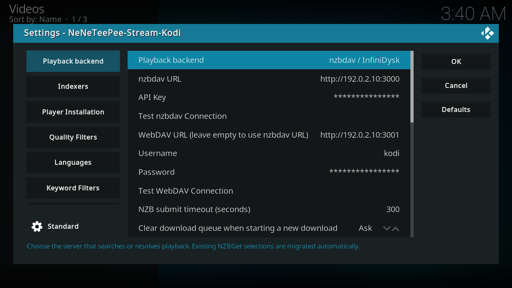
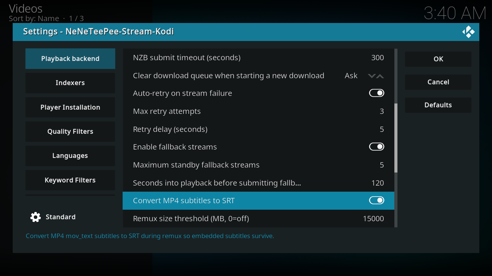
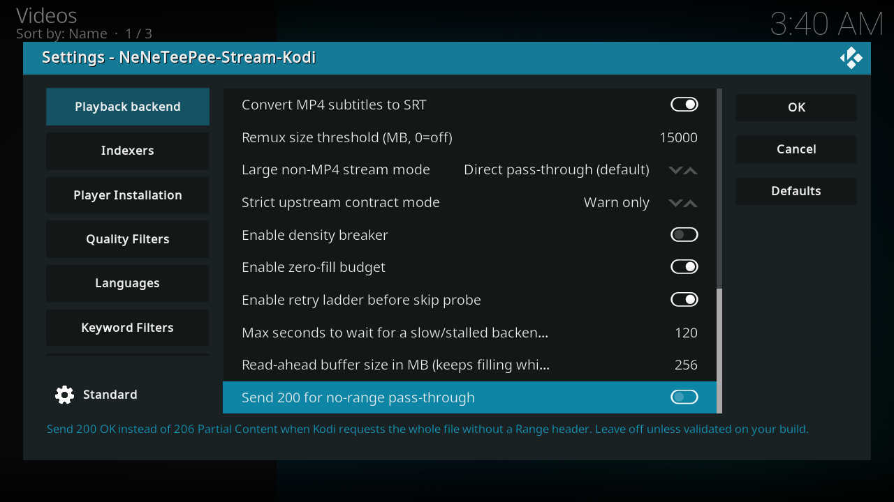
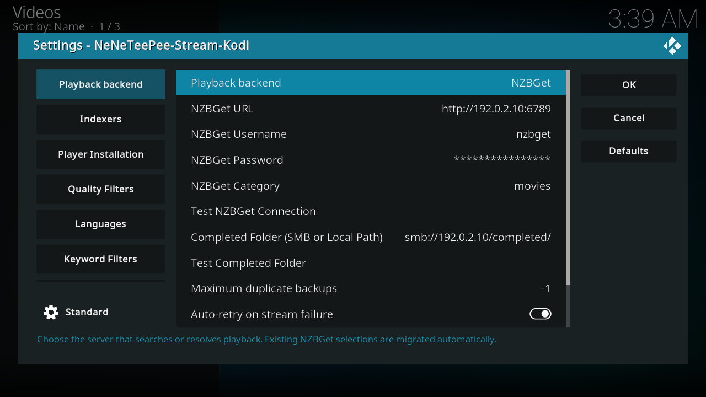
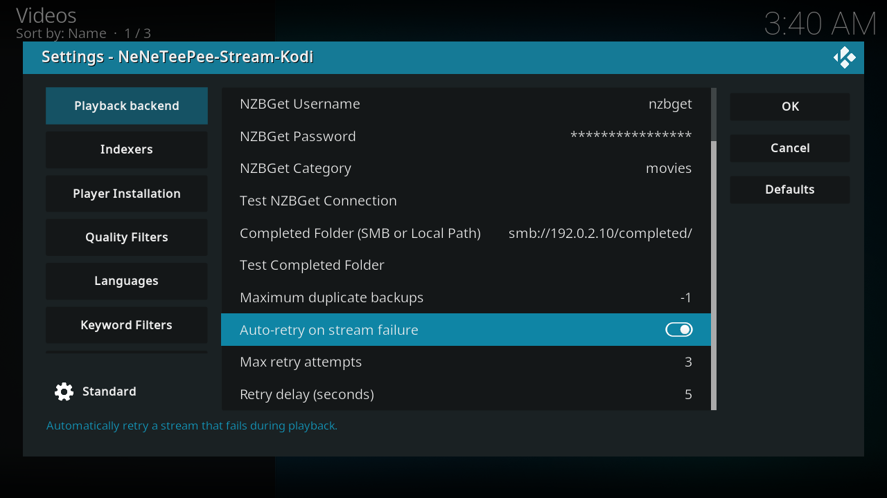
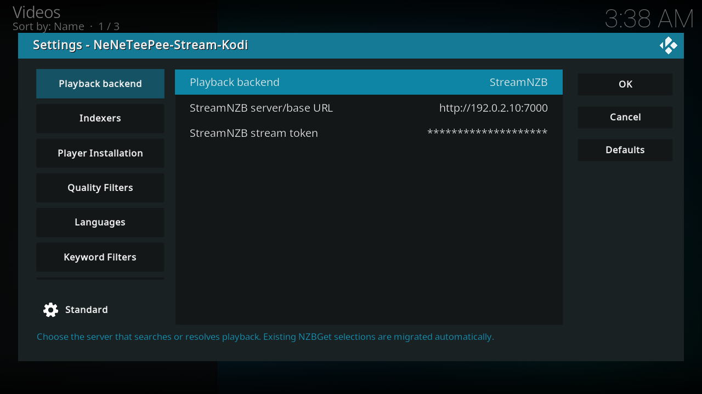

# Playback backend

Choose the service that resolves playback. The selected backend controls which connection fields and playback options Kodi shows. nzbdav / InfiniDysk submits NZBs through a SABnzbd-compatible API and streams over WebDAV. NZBGet downloads and unpacks the release before Kodi reads the completed file. StreamNZB searches on its server and returns an HTTP playback URL. Its playback bypasses the local proxy and local indexer clients. See the [backend setup guides](../backends/index.md) for connection examples.

These options appear in the same tab, after the selected backend's connection fields. Kodi shows them without group headings, as one list. This page groups them by function.

## Kodi screenshots

With **nzbdav / InfiniDysk** selected, the list scrolls through the connection fields and every playback option:

With **NZBGet** selected, the stream resilience options follow the NZBGet connection fields:

With **StreamNZB** selected, only the server URL and stream token appear:

Captured on the OrbStack Kodi VM from commit `5a50676`. Debug overlays are off, and credentials use example values. [Capture details](index.md#capture-details).

## Every option

### Connection options

| Option and setting ID | Default | What it does |
| --- | --- | --- |
| Playback backend[^source-playback_backend] `playback_backend` | nzbdav / InfiniDysk | Choose the server that searches or resolves playback. Existing NZBGet selections are migrated automatically. Choices: 0 = nzbdav / InfiniDysk, 1 = NZBGet, 2 = StreamNZB. |
| StreamNZB server/base URL[^source-streamnzb_url] `streamnzb_url` | Empty | Use an HTTP or HTTPS base URL reachable from Kodi. Localhost refers to the Kodi device. Visible when playback_backend = 2. |
| StreamNZB stream token[^source-streamnzb_token] `streamnzb_token` | Empty | Use a StreamNZB stream token from its Install page. This field is masked. Do not enter the dashboard administrator password. Kodi uses the token to authorize searches and playback URLs. Visible when playback_backend = 2. |
| nzbdav URL[^source-nzbdav_url] `nzbdav_url` | http://localhost:3000 | Base URL of your nzbdav server (SABnzbd-compatible API). Used to submit and poll downloads. Visible when playback_backend = 0. |
| API Key[^source-nzbdav_api_key] `nzbdav_api_key` | Empty | nzbdav API key, from Settings > Usenet > API Key in nzbdav. Visible when playback_backend = 0. |
| Test nzbdav Connection[^source-action_test_nzbdav] `action_test_nzbdav` | Button | Verify the nzbdav URL and API key are reachable and valid. Visible when playback_backend = 0. |
| WebDAV URL (leave empty to use nzbdav URL)[^source-webdav_url] `webdav_url` | http://localhost:8080 | Base URL of the WebDAV server used to stream files. Leave empty to reuse the nzbdav URL. Visible when playback_backend = 0. |
| Username[^source-webdav_username] `webdav_username` | Empty | WebDAV username, from Settings > WebDAV in nzbdav. Visible when playback_backend = 0. |
| Password[^source-webdav_password] `webdav_password` | Empty | WebDAV password. The dialog masks the value; the profile settings file stores it. Visible when playback_backend = 0. |
| Test WebDAV Connection[^source-action_test_webdav] `action_test_webdav` | Button | Verify WebDAV is reachable with the current URL and credentials. Visible when playback_backend = 0. |
| NZBGet URL[^source-nzbget_url] `nzbget_url` | http://localhost:6789 | NZBGet control address, for example http://host:6789. Visible when playback_backend = 1. |
| NZBGet Username[^source-nzbget_username] `nzbget_username` | nzbget | NZBGet control username. Visible when playback_backend = 1. |
| NZBGet Password[^source-nzbget_password] `nzbget_password` | Empty | NZBGet control password. The dialog masks the value; the profile settings file stores it. Visible when playback_backend = 1. |
| NZBGet Category[^source-nzbget_category] `nzbget_category` | Empty | Category to submit downloads under. Also used to help locate the completed file. Visible when playback_backend = 1. |
| Test NZBGet Connection[^source-action_test_nzbget] `action_test_nzbget` | Button | Verify NZBGet is reachable with the current URL and credentials. Visible when playback_backend = 1. |
| Completed Folder (SMB or Local Path)[^source-nzbget_smb_root] `nzbget_smb_root` | Empty | smb:// URL or local/mounted path of NZBGet's completed-downloads base, used to play the finished file. Visible when playback_backend = 1. |
| Test Completed Folder[^source-action_test_nzbget_smb] `action_test_nzbget_smb` | Button | Verify the completed-downloads folder (SMB share or local path) is reachable. Visible when playback_backend = 1. |
| Maximum duplicate backups `nzbget_max_backups` | -1 | How many other NZBs of the same release NeNeTeePee-Stream-Kodi sends to NZBGet as duplicate backups. `-1` sends every same-release NZB it finds, `0` sends none (a plain single submit), and a positive number sends at most that many. Every backup costs one indexer download, which counts against indexer API and grab limits. See [Smart Duplicates failover](../features/nzbget-backend.md#smart-duplicates-failover). Visible when playback_backend = 1. |

### Submit and queue (nzbdav / InfiniDysk)

These options appear only when **Playback backend** is nzbdav / InfiniDysk.

| Option and setting ID | Default | What it does |
| --- | --- | --- |
| NZB submit timeout (seconds)[^source-submit_timeout] `submit_timeout` | 300 | Max seconds to wait for nzbdav to accept the submitted NZB (it fetches and parses the NZB before replying). Clamped to 5-600. |
| Clear download queue when starting a new download[^source-clear_queue_on_submit] `clear_queue_on_submit` | Ask | Choose whether to clear other in-progress downloads before starting a new one. Never clears this title's own in-flight job or a completed copy you're about to reuse. Choices: 0 = Ask, 1 = Always clear, 2 = Never. |

### Stream resilience (nzbdav / InfiniDysk and NZBGet)

These options appear when **Playback backend** is nzbdav / InfiniDysk or NZBGet. They are hidden for StreamNZB because the background service's reconnect monitor doesn't watch StreamNZB playback.

| Option and setting ID | Default | What it does |
| --- | --- | --- |
| Auto-retry on stream failure[^source-stream_auto_retry] `stream_auto_retry` | On | Enable the local playback retry monitor. It retries failed playback from the recorded position when recovery information is available. The monitor runs for nzbdav / InfiniDysk and NZBGet playback; StreamNZB playback is not monitored. |
| Max retry attempts[^source-stream_max_retries] `stream_max_retries` | 3 | Limit local playback retry attempts. Runtime values are clamped to 0–10. |
| Retry delay (seconds)[^source-stream_retry_delay] `stream_retry_delay` | 5 | Wait this many seconds before a local playback retry. Runtime values are clamped to 1–300. |

### Fallback streams (nzbdav / InfiniDysk)

These options appear only when **Playback backend** is nzbdav / InfiniDysk. See [fallback streams](../features/fallback-streams.md). NZBGet duplicate backups are controlled only by **Maximum duplicate backups** in the NZBGet options in the preceding table.

| Option and setting ID | Default | What it does |
| --- | --- | --- |
| Enable fallback streams[^source-fallback_streams_enabled] `fallback_streams_enabled` | On | Prepare validated proxy backup streams and try another source when the current source fails. This does not guarantee an uninterrupted switch. It has no effect on NZBGet duplicate backups; use **Maximum duplicate backups** (`nzbget_max_backups`) for those. |
| Maximum standby fallback streams[^source-fallback_streams_max] `fallback_streams_max` | 5 | Limit standby proxy streams per title; runtime values are clamped to 0–5. |
| Seconds into playback before submitting fallback backups[^source-fallback_submit_delay] `fallback_submit_delay` | 120 | Wait this many seconds into playback before submitting proxy fallback backups. 0 submits immediately. |

### Proxy (nzbdav / InfiniDysk)

These options appear only when **Playback backend** is nzbdav / InfiniDysk, the only backend that plays through the add-on's stream proxy.

| Option and setting ID | Default | What it does |
| --- | --- | --- |
| Convert MP4 subtitles to SRT[^source-proxy_convert_subs] `proxy_convert_subs` | On | Convert MP4 mov_text subtitles to SRT during remux so embedded subtitles survive. |
| Remux size threshold (MB, 0=off)[^source-force_remux_threshold_mb] `force_remux_threshold_mb` | 15000 | For non-MP4 streams, apply the selected remux mode at least this size in MB; an unknown length also triggers the selected remux mode when the threshold is positive. MP4/M4V uses a separate playback path and ignores this threshold. 0 turns off this size-triggered remux rule. |
| Large non-MP4 stream mode[^source-force_remux_mode] `force_remux_mode` | Direct pass-through (default) | How to handle large non-MP4 streams: pass through directly, remux to fMP4/HLS, or remux to Matroska for compatibility. Choices: 0 = Direct pass-through (default), 1 = fMP4 HLS (compatibility, experimental), 2 = Matroska remux (compatibility). |
| force_remux_mode_v2_migrated[^source-force_remux_mode_v2_migrated] `force_remux_mode_v2_migrated` | Off | Hidden one-time migration flag for remux-mode settings. The add-on manages it; do not change it manually. Hidden from the settings dialog. |

### Pass-through validation (nzbdav / InfiniDysk)

These options appear only when **Playback backend** is nzbdav / InfiniDysk.

| Option and setting ID | Default | What it does |
| --- | --- | --- |
| Strict upstream contract mode[^source-strict_contract_mode] `strict_contract_mode` | Warn only | How to react when the upstream server violates the expected Range/Content-Length contract. Off also disables the density breaker below. Choices: 0 = Off, 1 = Warn only, 2 = Enforce. |
| Enable density breaker[^source-density_breaker_enabled] `density_breaker_enabled` | Off | Stop a stream early if a rolling 16MB window becomes more than half zero-filled, which usually means a dead release. Only active when Strict upstream contract mode isn't Off. |
| Enable zero-fill budget[^source-zero_fill_budget_enabled] `zero_fill_budget_enabled` | On | Limit the total concealed missing data in a proxy stream. When the budget is exhausted, stop with an error. For validated MKV/WebM boundaries, the proxy can write correctly sized EBML Void elements while preserving byte offsets. Missing payload or unknown structure can still use plain zeros; no missing frames are reconstructed. |
| Enable retry ladder before skip probe[^source-retry_ladder_enabled] `retry_ladder_enabled` | On | Re-issue the original range request with backoff on transient upstream errors before falling back to skip-filling. |
| Max seconds to wait for a slow/stalled backend before giving up (0=off)[^source-passthrough_stall_wait] `passthrough_stall_wait` | 120 | Max seconds to hold an established stream open through a recoverable backend stall before giving up. 0 closes immediately. Clamped to 0-600. |
| Read-ahead buffer size in MB (keeps filling while paused; 0=off)[^source-readahead_buffer_mb] `readahead_buffer_mb` | 256 | Size in MB of the per-session forward read-ahead buffer. Keeps filling while paused. 0 disables it. Clamped to 0-4096. |
| Send 200 for no-range pass-through[^source-send_200_no_range] `send_200_no_range` | Off | Send 200 OK instead of 206 Partial Content when Kodi requests the whole file without a Range header. Leave off unless validated on your build. |
| webdav_content_root[^source-webdav_content_root] `webdav_content_root` | Empty | Hidden override for the WebDAV content-root path. Empty uses content. Use only when a reverse proxy or server exposes a different content root. Hidden from the settings dialog. |
| nzbget_backup_switch_migrated `nzbget_backup_switch_migrated` | Off | Hidden one-time migration flag for the NZBGet duplicate-backup setting. The add-on manages it; do not change it manually. Hidden from the settings dialog. |

## Source notes

Labels and schema defaults are from commit [`db07f61`](https://github.com/Appz4Fun/NeNeTeePee-Stream-Kodi/blob/db07f61d4090a0c89ec8461ee9b3ca34f9607aa6/repo/plugin.video.nzbdav/resources/settings.xml). Runtime limits can differ from the editable schema; the explanations identify those limits. Links use the full commit ID, so later changes to `main` do not move them.

[^source-playback_backend]: [Setting declaration](https://github.com/Appz4Fun/NeNeTeePee-Stream-Kodi/blob/db07f61d4090a0c89ec8461ee9b3ca34f9607aa6/repo/plugin.video.nzbdav/resources/settings.xml#L7); [runtime reference](https://github.com/Appz4Fun/NeNeTeePee-Stream-Kodi/blob/db07f61d4090a0c89ec8461ee9b3ca34f9607aa6/repo/plugin.video.nzbdav/resources/lib/playback_backend.py#L23).
[^source-streamnzb_url]: [Setting declaration](https://github.com/Appz4Fun/NeNeTeePee-Stream-Kodi/blob/db07f61d4090a0c89ec8461ee9b3ca34f9607aa6/repo/plugin.video.nzbdav/resources/settings.xml#L17); [runtime reference](https://github.com/Appz4Fun/NeNeTeePee-Stream-Kodi/blob/db07f61d4090a0c89ec8461ee9b3ca34f9607aa6/repo/plugin.video.nzbdav/resources/lib/streamnzb_player.py#L111).
[^source-streamnzb_token]: [Setting declaration](https://github.com/Appz4Fun/NeNeTeePee-Stream-Kodi/blob/db07f61d4090a0c89ec8461ee9b3ca34f9607aa6/repo/plugin.video.nzbdav/resources/settings.xml#L24); [runtime reference](https://github.com/Appz4Fun/NeNeTeePee-Stream-Kodi/blob/db07f61d4090a0c89ec8461ee9b3ca34f9607aa6/repo/plugin.video.nzbdav/resources/lib/streamnzb_player.py#L106).
[^source-nzbdav_url]: [Setting declaration](https://github.com/Appz4Fun/NeNeTeePee-Stream-Kodi/blob/db07f61d4090a0c89ec8461ee9b3ca34f9607aa6/repo/plugin.video.nzbdav/resources/settings.xml#L31); [runtime reference](https://github.com/Appz4Fun/NeNeTeePee-Stream-Kodi/blob/db07f61d4090a0c89ec8461ee9b3ca34f9607aa6/repo/plugin.video.nzbdav/resources/lib/fallback_streams_probe.py#L313).
[^source-nzbdav_api_key]: [Setting declaration](https://github.com/Appz4Fun/NeNeTeePee-Stream-Kodi/blob/db07f61d4090a0c89ec8461ee9b3ca34f9607aa6/repo/plugin.video.nzbdav/resources/settings.xml#L44); [runtime reference](https://github.com/Appz4Fun/NeNeTeePee-Stream-Kodi/blob/db07f61d4090a0c89ec8461ee9b3ca34f9607aa6/repo/plugin.video.nzbdav/resources/lib/nzbdav_api.py#L81).
[^source-action_test_nzbdav]: [Setting declaration](https://github.com/Appz4Fun/NeNeTeePee-Stream-Kodi/blob/db07f61d4090a0c89ec8461ee9b3ca34f9607aa6/repo/plugin.video.nzbdav/resources/settings.xml#L58).
[^source-webdav_url]: [Setting declaration](https://github.com/Appz4Fun/NeNeTeePee-Stream-Kodi/blob/db07f61d4090a0c89ec8461ee9b3ca34f9607aa6/repo/plugin.video.nzbdav/resources/settings.xml#L68); [runtime reference](https://github.com/Appz4Fun/NeNeTeePee-Stream-Kodi/blob/db07f61d4090a0c89ec8461ee9b3ca34f9607aa6/repo/plugin.video.nzbdav/resources/lib/fallback_streams_probe.py#L312).
[^source-webdav_username]: [Setting declaration](https://github.com/Appz4Fun/NeNeTeePee-Stream-Kodi/blob/db07f61d4090a0c89ec8461ee9b3ca34f9607aa6/repo/plugin.video.nzbdav/resources/settings.xml#L81); [runtime reference](https://github.com/Appz4Fun/NeNeTeePee-Stream-Kodi/blob/db07f61d4090a0c89ec8461ee9b3ca34f9607aa6/repo/plugin.video.nzbdav/resources/lib/webdav.py#L92).
[^source-webdav_password]: [Setting declaration](https://github.com/Appz4Fun/NeNeTeePee-Stream-Kodi/blob/db07f61d4090a0c89ec8461ee9b3ca34f9607aa6/repo/plugin.video.nzbdav/resources/settings.xml#L94); [runtime reference](https://github.com/Appz4Fun/NeNeTeePee-Stream-Kodi/blob/db07f61d4090a0c89ec8461ee9b3ca34f9607aa6/repo/plugin.video.nzbdav/resources/lib/webdav.py#L93).
[^source-action_test_webdav]: [Setting declaration](https://github.com/Appz4Fun/NeNeTeePee-Stream-Kodi/blob/db07f61d4090a0c89ec8461ee9b3ca34f9607aa6/repo/plugin.video.nzbdav/resources/settings.xml#L108).
[^source-nzbget_url]: [Setting declaration](https://github.com/Appz4Fun/NeNeTeePee-Stream-Kodi/blob/db07f61d4090a0c89ec8461ee9b3ca34f9607aa6/repo/plugin.video.nzbdav/resources/settings.xml#L118); [runtime reference](https://github.com/Appz4Fun/NeNeTeePee-Stream-Kodi/blob/db07f61d4090a0c89ec8461ee9b3ca34f9607aa6/repo/plugin.video.nzbdav/resources/lib/nzbget_api.py#L37).
[^source-nzbget_username]: [Setting declaration](https://github.com/Appz4Fun/NeNeTeePee-Stream-Kodi/blob/db07f61d4090a0c89ec8461ee9b3ca34f9607aa6/repo/plugin.video.nzbdav/resources/settings.xml#L131); [runtime reference](https://github.com/Appz4Fun/NeNeTeePee-Stream-Kodi/blob/db07f61d4090a0c89ec8461ee9b3ca34f9607aa6/repo/plugin.video.nzbdav/resources/lib/nzbget_api.py#L38).
[^source-nzbget_password]: [Setting declaration](https://github.com/Appz4Fun/NeNeTeePee-Stream-Kodi/blob/db07f61d4090a0c89ec8461ee9b3ca34f9607aa6/repo/plugin.video.nzbdav/resources/settings.xml#L144); [runtime reference](https://github.com/Appz4Fun/NeNeTeePee-Stream-Kodi/blob/db07f61d4090a0c89ec8461ee9b3ca34f9607aa6/repo/plugin.video.nzbdav/resources/lib/nzbget_api.py#L39).
[^source-nzbget_category]: [Setting declaration](https://github.com/Appz4Fun/NeNeTeePee-Stream-Kodi/blob/db07f61d4090a0c89ec8461ee9b3ca34f9607aa6/repo/plugin.video.nzbdav/resources/settings.xml#L158); [runtime reference](https://github.com/Appz4Fun/NeNeTeePee-Stream-Kodi/blob/db07f61d4090a0c89ec8461ee9b3ca34f9607aa6/repo/plugin.video.nzbdav/resources/lib/nzbget_api.py#L40).
[^source-action_test_nzbget]: [Setting declaration](https://github.com/Appz4Fun/NeNeTeePee-Stream-Kodi/blob/db07f61d4090a0c89ec8461ee9b3ca34f9607aa6/repo/plugin.video.nzbdav/resources/settings.xml#L171).
[^source-nzbget_smb_root]: [Setting declaration](https://github.com/Appz4Fun/NeNeTeePee-Stream-Kodi/blob/db07f61d4090a0c89ec8461ee9b3ca34f9607aa6/repo/plugin.video.nzbdav/resources/settings.xml#L181); [runtime reference](https://github.com/Appz4Fun/NeNeTeePee-Stream-Kodi/blob/db07f61d4090a0c89ec8461ee9b3ca34f9607aa6/repo/plugin.video.nzbdav/resources/lib/nzbget_resolver.py#L430).
[^source-action_test_nzbget_smb]: [Setting declaration](https://github.com/Appz4Fun/NeNeTeePee-Stream-Kodi/blob/db07f61d4090a0c89ec8461ee9b3ca34f9607aa6/repo/plugin.video.nzbdav/resources/settings.xml#L194); [runtime reference](https://github.com/Appz4Fun/NeNeTeePee-Stream-Kodi/blob/db07f61d4090a0c89ec8461ee9b3ca34f9607aa6/repo/plugin.video.nzbdav/resources/lib/router_conn.py#L203).
[^source-submit_timeout]: [Setting declaration](https://github.com/Appz4Fun/NeNeTeePee-Stream-Kodi/blob/db07f61d4090a0c89ec8461ee9b3ca34f9607aa6/repo/plugin.video.nzbdav/resources/settings.xml#L1354); [runtime reference](https://github.com/Appz4Fun/NeNeTeePee-Stream-Kodi/blob/db07f61d4090a0c89ec8461ee9b3ca34f9607aa6/repo/plugin.video.nzbdav/resources/lib/nzbdav_api.py#L107).
[^source-clear_queue_on_submit]: [Setting declaration](https://github.com/Appz4Fun/NeNeTeePee-Stream-Kodi/blob/db07f61d4090a0c89ec8461ee9b3ca34f9607aa6/repo/plugin.video.nzbdav/resources/settings.xml#L1361); [runtime reference](https://github.com/Appz4Fun/NeNeTeePee-Stream-Kodi/blob/db07f61d4090a0c89ec8461ee9b3ca34f9607aa6/repo/plugin.video.nzbdav/resources/lib/resolver_queueclear.py#L29).
[^source-stream_auto_retry]: [Setting declaration](https://github.com/Appz4Fun/NeNeTeePee-Stream-Kodi/blob/db07f61d4090a0c89ec8461ee9b3ca34f9607aa6/repo/plugin.video.nzbdav/resources/settings.xml#L1384); [runtime reference](https://github.com/Appz4Fun/NeNeTeePee-Stream-Kodi/blob/db07f61d4090a0c89ec8461ee9b3ca34f9607aa6/repo/plugin.video.nzbdav/service.py#L190).
[^source-stream_max_retries]: [Setting declaration](https://github.com/Appz4Fun/NeNeTeePee-Stream-Kodi/blob/db07f61d4090a0c89ec8461ee9b3ca34f9607aa6/repo/plugin.video.nzbdav/resources/settings.xml#L1389); [runtime reference](https://github.com/Appz4Fun/NeNeTeePee-Stream-Kodi/blob/db07f61d4090a0c89ec8461ee9b3ca34f9607aa6/repo/plugin.video.nzbdav/service.py#L194).
[^source-stream_retry_delay]: [Setting declaration](https://github.com/Appz4Fun/NeNeTeePee-Stream-Kodi/blob/db07f61d4090a0c89ec8461ee9b3ca34f9607aa6/repo/plugin.video.nzbdav/resources/settings.xml#L1396); [runtime reference](https://github.com/Appz4Fun/NeNeTeePee-Stream-Kodi/blob/db07f61d4090a0c89ec8461ee9b3ca34f9607aa6/repo/plugin.video.nzbdav/service.py#L198).
[^source-fallback_streams_enabled]: [Setting declaration](https://github.com/Appz4Fun/NeNeTeePee-Stream-Kodi/blob/db07f61d4090a0c89ec8461ee9b3ca34f9607aa6/repo/plugin.video.nzbdav/resources/settings.xml#L1405); [runtime reference](https://github.com/Appz4Fun/NeNeTeePee-Stream-Kodi/blob/db07f61d4090a0c89ec8461ee9b3ca34f9607aa6/repo/plugin.video.nzbdav/resources/lib/fallback_streams_select.py#L34).
[^source-fallback_streams_max]: [Setting declaration](https://github.com/Appz4Fun/NeNeTeePee-Stream-Kodi/blob/db07f61d4090a0c89ec8461ee9b3ca34f9607aa6/repo/plugin.video.nzbdav/resources/settings.xml#L1410); [runtime reference](https://github.com/Appz4Fun/NeNeTeePee-Stream-Kodi/blob/db07f61d4090a0c89ec8461ee9b3ca34f9607aa6/repo/plugin.video.nzbdav/resources/lib/fallback_streams_select.py#L35).
[^source-fallback_submit_delay]: [Setting declaration](https://github.com/Appz4Fun/NeNeTeePee-Stream-Kodi/blob/db07f61d4090a0c89ec8461ee9b3ca34f9607aa6/repo/plugin.video.nzbdav/resources/settings.xml#L1417); [runtime reference](https://github.com/Appz4Fun/NeNeTeePee-Stream-Kodi/blob/db07f61d4090a0c89ec8461ee9b3ca34f9607aa6/repo/plugin.video.nzbdav/resources/lib/resolver_fallback.py#L381).
[^source-proxy_convert_subs]: [Setting declaration](https://github.com/Appz4Fun/NeNeTeePee-Stream-Kodi/blob/db07f61d4090a0c89ec8461ee9b3ca34f9607aa6/repo/plugin.video.nzbdav/resources/settings.xml#L1426); [runtime reference](https://github.com/Appz4Fun/NeNeTeePee-Stream-Kodi/blob/db07f61d4090a0c89ec8461ee9b3ca34f9607aa6/repo/plugin.video.nzbdav/resources/lib/stream_proxy_const.py#L323).
[^source-force_remux_threshold_mb]: [Setting declaration](https://github.com/Appz4Fun/NeNeTeePee-Stream-Kodi/blob/db07f61d4090a0c89ec8461ee9b3ca34f9607aa6/repo/plugin.video.nzbdav/resources/settings.xml#L1431); [runtime reference](https://github.com/Appz4Fun/NeNeTeePee-Stream-Kodi/blob/db07f61d4090a0c89ec8461ee9b3ca34f9607aa6/repo/plugin.video.nzbdav/resources/lib/stream_proxy_const.py#L315).
[^source-force_remux_mode]: [Setting declaration](https://github.com/Appz4Fun/NeNeTeePee-Stream-Kodi/blob/db07f61d4090a0c89ec8461ee9b3ca34f9607aa6/repo/plugin.video.nzbdav/resources/settings.xml#L1438); [runtime reference](https://github.com/Appz4Fun/NeNeTeePee-Stream-Kodi/blob/db07f61d4090a0c89ec8461ee9b3ca34f9607aa6/repo/plugin.video.nzbdav/resources/lib/stream_proxy_const.py#L316).
[^source-force_remux_mode_v2_migrated]: [Setting declaration](https://github.com/Appz4Fun/NeNeTeePee-Stream-Kodi/blob/db07f61d4090a0c89ec8461ee9b3ca34f9607aa6/repo/plugin.video.nzbdav/resources/settings.xml#L1450); [runtime reference](https://github.com/Appz4Fun/NeNeTeePee-Stream-Kodi/blob/db07f61d4090a0c89ec8461ee9b3ca34f9607aa6/repo/plugin.video.nzbdav/resources/lib/stream_proxy_const.py#L317).
[^source-strict_contract_mode]: [Setting declaration](https://github.com/Appz4Fun/NeNeTeePee-Stream-Kodi/blob/db07f61d4090a0c89ec8461ee9b3ca34f9607aa6/repo/plugin.video.nzbdav/resources/settings.xml#L1458); [runtime reference](https://github.com/Appz4Fun/NeNeTeePee-Stream-Kodi/blob/db07f61d4090a0c89ec8461ee9b3ca34f9607aa6/repo/plugin.video.nzbdav/resources/lib/stream_proxy_const.py#L318).
[^source-density_breaker_enabled]: [Setting declaration](https://github.com/Appz4Fun/NeNeTeePee-Stream-Kodi/blob/db07f61d4090a0c89ec8461ee9b3ca34f9607aa6/repo/plugin.video.nzbdav/resources/settings.xml#L1470); [runtime reference](https://github.com/Appz4Fun/NeNeTeePee-Stream-Kodi/blob/db07f61d4090a0c89ec8461ee9b3ca34f9607aa6/repo/plugin.video.nzbdav/resources/lib/stream_proxy_const.py#L319).
[^source-zero_fill_budget_enabled]: [Setting declaration](https://github.com/Appz4Fun/NeNeTeePee-Stream-Kodi/blob/db07f61d4090a0c89ec8461ee9b3ca34f9607aa6/repo/plugin.video.nzbdav/resources/settings.xml#L1475); [runtime reference](https://github.com/Appz4Fun/NeNeTeePee-Stream-Kodi/blob/db07f61d4090a0c89ec8461ee9b3ca34f9607aa6/repo/plugin.video.nzbdav/resources/lib/stream_proxy_const.py#L320).
[^source-retry_ladder_enabled]: [Setting declaration](https://github.com/Appz4Fun/NeNeTeePee-Stream-Kodi/blob/db07f61d4090a0c89ec8461ee9b3ca34f9607aa6/repo/plugin.video.nzbdav/resources/settings.xml#L1480); [runtime reference](https://github.com/Appz4Fun/NeNeTeePee-Stream-Kodi/blob/db07f61d4090a0c89ec8461ee9b3ca34f9607aa6/repo/plugin.video.nzbdav/resources/lib/stream_proxy_const.py#L321).
[^source-passthrough_stall_wait]: [Setting declaration](https://github.com/Appz4Fun/NeNeTeePee-Stream-Kodi/blob/db07f61d4090a0c89ec8461ee9b3ca34f9607aa6/repo/plugin.video.nzbdav/resources/settings.xml#L1485); [runtime reference](https://github.com/Appz4Fun/NeNeTeePee-Stream-Kodi/blob/db07f61d4090a0c89ec8461ee9b3ca34f9607aa6/repo/plugin.video.nzbdav/resources/lib/stream_proxy_const.py#L328).
[^source-readahead_buffer_mb]: [Setting declaration](https://github.com/Appz4Fun/NeNeTeePee-Stream-Kodi/blob/db07f61d4090a0c89ec8461ee9b3ca34f9607aa6/repo/plugin.video.nzbdav/resources/settings.xml#L1492); [runtime reference](https://github.com/Appz4Fun/NeNeTeePee-Stream-Kodi/blob/db07f61d4090a0c89ec8461ee9b3ca34f9607aa6/repo/plugin.video.nzbdav/resources/lib/stream_proxy_const.py#L324).
[^source-send_200_no_range]: [Setting declaration](https://github.com/Appz4Fun/NeNeTeePee-Stream-Kodi/blob/db07f61d4090a0c89ec8461ee9b3ca34f9607aa6/repo/plugin.video.nzbdav/resources/settings.xml#L1499); [runtime reference](https://github.com/Appz4Fun/NeNeTeePee-Stream-Kodi/blob/db07f61d4090a0c89ec8461ee9b3ca34f9607aa6/repo/plugin.video.nzbdav/resources/lib/stream_proxy_const.py#L322).
[^source-webdav_content_root]: [Setting declaration](https://github.com/Appz4Fun/NeNeTeePee-Stream-Kodi/blob/db07f61d4090a0c89ec8461ee9b3ca34f9607aa6/repo/plugin.video.nzbdav/resources/settings.xml#L1516); [runtime reference](https://github.com/Appz4Fun/NeNeTeePee-Stream-Kodi/blob/db07f61d4090a0c89ec8461ee9b3ca34f9607aa6/repo/plugin.video.nzbdav/resources/lib/webdav.py#L202).

The non-MP4 decision is implemented in [the force-remux selector](https://github.com/Appz4Fun/NeNeTeePee-Stream-Kodi/blob/db07f61d4090a0c89ec8461ee9b3ca34f9607aa6/repo/plugin.video.nzbdav/resources/lib/stream_proxy_mgr_context.py#L445); [MP4 dispatch](https://github.com/Appz4Fun/NeNeTeePee-Stream-Kodi/blob/db07f61d4090a0c89ec8461ee9b3ca34f9607aa6/repo/plugin.video.nzbdav/resources/lib/stream_proxy_mgr_handoff.py#L162) takes the separate path.
